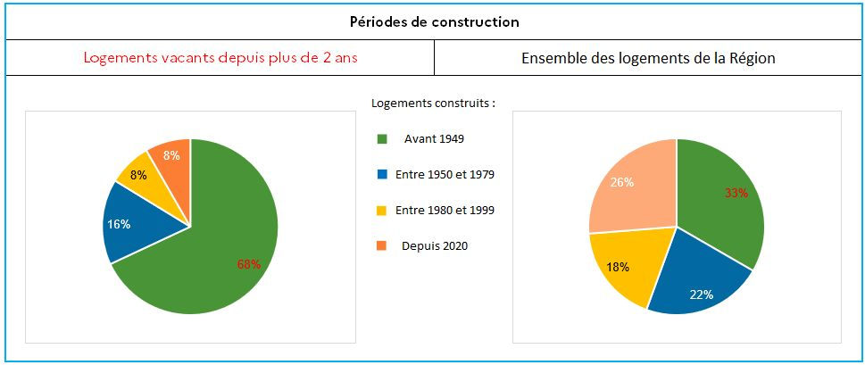
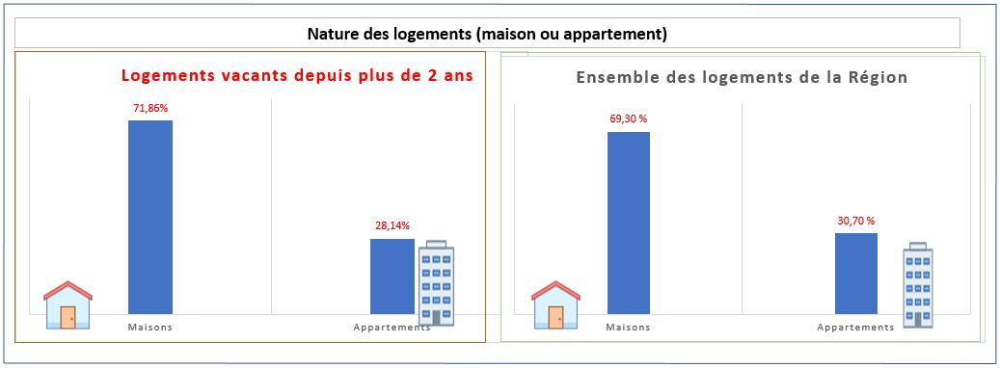
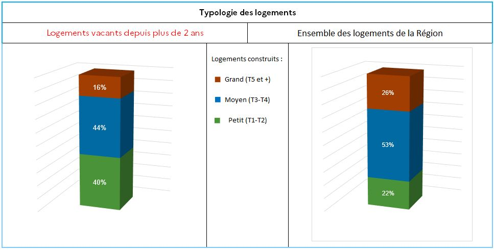
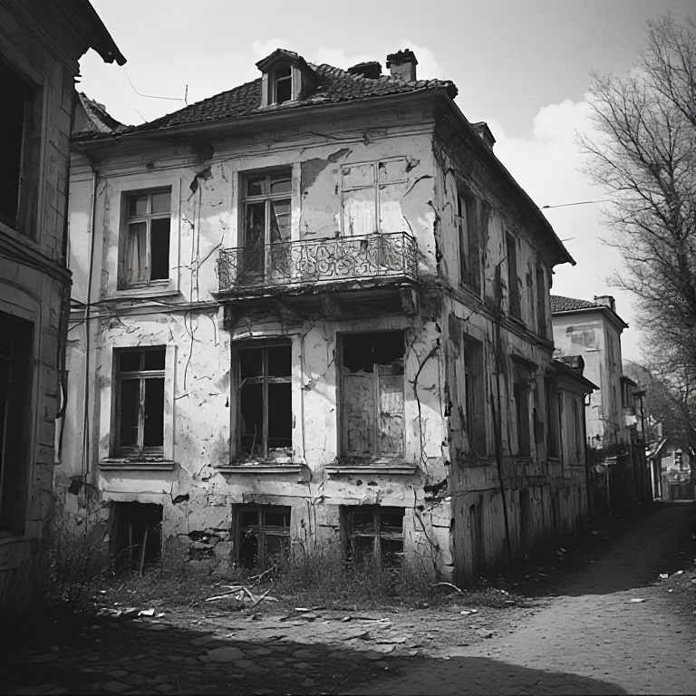
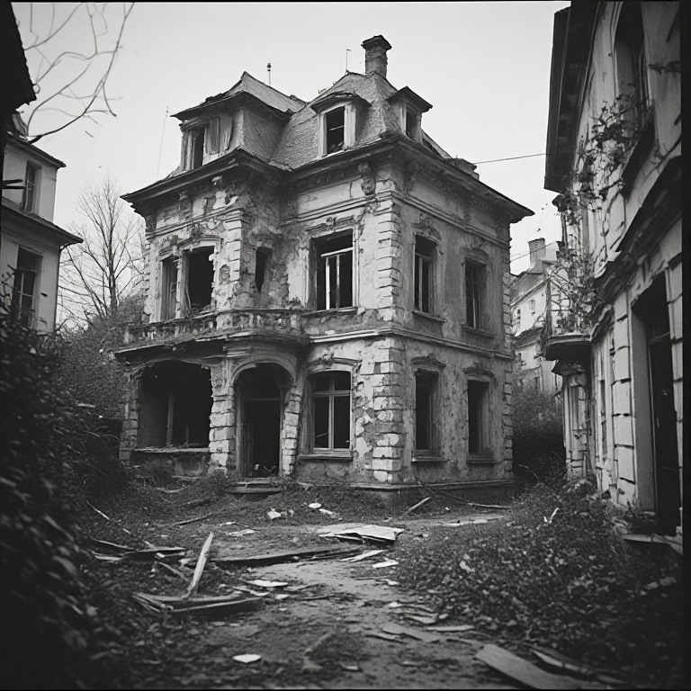
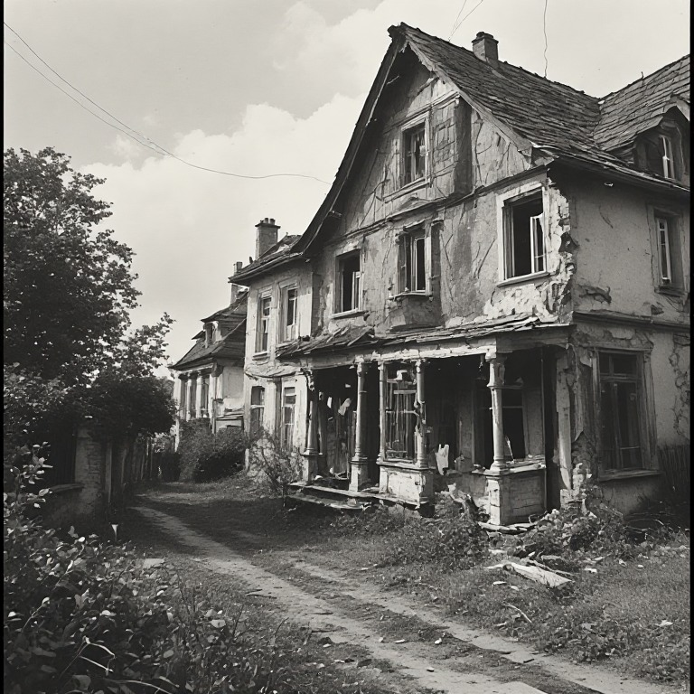
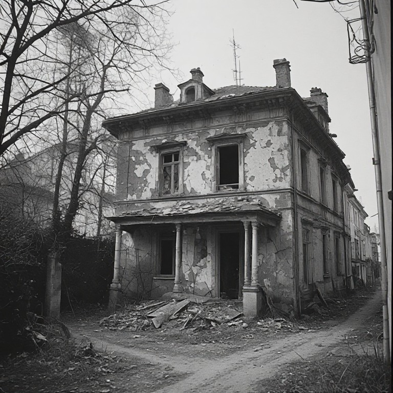

```{=html}
<style>
  p {
  text-align: inherit !important;
  }

.img-stack {
  position: relative;
  width: 100%;
  max-width: 900px;
  margin: auto;
  aspect-ratio: 3 / 1; /* hauteur fluide */
}

/* Images superposées */
.img-stack img {
  position: absolute;
  object-fit: contain;
  max-width: 100%;
  margin-top: -65px;
}

/* Image du dessus */
.img-top {
  width: 60%;
  right: 2%;
  top: 0;
}

/* Image du dessous */
.img-bottom {
  width: 40%;
  right: 35%;
  top: 15%;
}

/* --- Responsive fluide --- */
@media (max-width: 900px) {
  .img-top {
    width: 65%;
    right: 0;
    top: 5%;
  }
  .img-bottom {
    width: 45%;
    right: 30%;
    top: 20%;
  }
}

@media (max-width: 600px) {
  .img-top {
    width: 70%;
    right: 0;
    top: 10%;
  }
  .img-bottom {
    width: 50%;
    right: 25%;
    top: 25%;
  }
}

@media (max-width: 450px) {
  .img-top {
    width: 75%;
    right: 0;
    top: 15%;
  }
  .img-bottom {
    width: 55%;
    right: 20%;
    top: 30%;
  }
}

  
  .triple-overlap {
    position: relative;
    width: 100%;
    display: flex;
    justify-content: center; /* centre le groupe */
    align-items: center;
    text-align: center;
  }

  .triple-overlap img {
    width: 36%; /* taille des images */
  }

  /* Image de gauche */
  .img-left {
    position: relative;
    z-index: 1;
  }

  /* Image du milieu (au-dessus) */
  .img-middle {
    position: relative;
    z-index: 3; /* passe au-dessus */
    margin: 0 -6%; /* chevauchement horizontal */
    margin-top: -4%; /* chevauchement vertical */
  }

  /* Image de droite */
  .img-right {
    position: relative;
    z-index: 1;
  }

  /* Responsive */
  @media (max-width: 800px) {
    .triple-overlap img {
      width: 35%;
    }
    .img-middle {
      margin: 0 -8%;
      margin-top: -6%;
    }
  }

  @media (max-width: 500px) {
    .triple-overlap img {
      width: 45%;
    }
    .img-middle {
      margin: 0 -10%;
      margin-top: -8%;
    }
  }
</style>
```

## 4. Les caractéristiques des logements vacants (longue durée) du parc privé.
::: {style="font-family: YACkoD1yZN0-0;font-size:1.1em;"}
La vacance concerne quasiment uniquement le parc privé (locatif ou non) : dans tous les  EPCI, 97 % au moins des logements vacants de plus de deux ans sont des logements privés. La matrice fournie (document à part disponible avec l’étude) fournit les caractéristiques du parc privé et social vacant.  

Voir chapitre in fine sur la vacance dans le parc social.
:::

### 4.1 Les logements vacants majoritairement anciens
::: {style="font-family: YACkoD1yZN0-0;font-size:1.1em;"}
Le parc privé vacant depuis plus de deux ans se caractérise par une **forte surreprésentation des logements anciens.** Ainsi, **68 % des logements durablement vacants ont été construits avant 1949**, alors que cette période de construction ne représente que **33 % de l’ensemble du parc de logements régional.**  

À contrario, les logements plus récents sont nettement moins représentés parmi les logements vacants de longue durée. Les logements construits **à partir de 1980 représentent 44 % du parc régional**, mais seulement **16 % des logements vacants depuis plus de deux ans.**  

Ces résultats mettent ainsi en évidence **un lien marqué entre ancienneté du bâti et vacance de longue durée.** Ils peuvent notamment traduire une moindre adéquation d’une partie du parc ancien aux attentes actuelles ou des besoins plus importants en matière de rénovation et de remise aux normes. La période de construction ne permet toutefois pas, à elle seule, d’identifier les causes de la vacance.

::: center
{.lightbox}
:::

:::

### 4.2 Une majorité de maisons parmi les logements vacants qui cache des disparités entre les territoires
::: {style="font-family: YACkoD1yZN0-0;font-size:1.1em;"}

{.lightbox}

À l’échelle régionale, la répartition des logements privés vacants depuis plus de deux ans est relativement proche de celle de l’ensemble du parc : **71,9 % des logements durablement vacants sont des maisons, contre 69,3 % dans le parc régional.** Les maisons ne sont donc que légèrement surreprésentées dans la vacance longue.  

**Cette moyenne régionale masque toutefois des situations locales très contrastées.** Dans de nombreuses villes et communes-centres, la vacance de longue durée concerne majoritairement des appartements, tandis que dans les territoires ruraux, où le parc est essentiellement composé de maisons individuelles, celles-ci prédominent logiquement parmi les logements vacants.  

À titre d’exemple, les appartements représentent la majorité des logements privés vacants de plus de deux ans à La Rochelle, Rochefort, Brive-la-Gaillarde, Aubusson ou encore Pau. Limoges compte 5 fois plus d’appartements vacants (longue durée) que de maison, Poitiers compte trois fois plus d’appartements vacants...  

**La nature du logement ne semble donc pas constituer, à elle seule, un facteur explicatif de la vacance longue : son analyse doit être mise en regard de la structure locale du parc et du type de territoire.**
:::


### 4.3 Une sur-représentation des petits logements
::: {style="font-family: YACkoD1yZN0-0;font-size:1.1em;"}
Les **[petits logements (T1-T2)]{style="cursor:pointer; color: #42429f;" data-bs-toggle="tooltip" title="Dans cette étude, la typologie des logements correspond au nombre de pièces principales : T1 pour une pièce principale, T2 pour deux, etc. Les cuisines, salles de bains et autres pièces de service ne sont pas comptabilisées."}** sont nettement surreprésentés parmi les logements vacants depuis plus de deux ans. Ils représentent **40 % de la vacance longue**, alors qu’ils ne constituent que **22 % de l’ensemble du parc régional.**  

À l’inverse, **les grands logements (T5 et plus)** sont sous-représentés parmi les logements durablement vacants : ils représentent **16 % des logements vacants depuis plus de deux ans**, contre **26 % du parc régional.** Les logements de taille intermédiaire **(T3-T4)** présentent une répartition plus proche de celle observée dans l’ensemble du parc, avec **44 % des logements vacants**, contre **53 % du parc régional.**  

Ces résultats suggèrent ainsi que **la vacance de longue durée touche proportionnellement davantage les petits logements,** tandis que les grands logements apparaissent moins concernés.

{.lightbox}
:::

### 4.4 Qualité du bâti : un parc vacant présentant des niveaux de qualité supposée contrastés
::: {style="font-family: YACkoD1yZN0-0;font-size:1.1em;"}
Le **[classement cadastral]{style="cursor:pointer; color: #42429f;" data-bs-toggle="tooltip" title="Le classement cadastral est un indicateur de la qualité générale du logement établi notamment à partir du caractère architectural du bâtiment, de la qualité de la construction et de ses équipements. Utilisé pour déterminer la valeur locative cadastrale, il distingue huit catégories, de la catégorie 1, correspondant aux logements présentant les caractéristiques les plus favorables, à la catégorie 8, correspondant aux logements les plus dégradés. Il s’agit toutefois d’un classement fiscal, qui ne constitue pas un diagnostic actualisé de l’état du logement."}** permet d’apporter une première indication sur la qualité générale des logements vacants. Les catégories les moins favorables, notamment les catégories **7 et 8**, correspondent aux logements présentant les caractéristiques de bâti les plus dégradées. La catégorie **6**, plus hétérogène, correspond à un niveau de qualité plus modeste et ne peut être assimilée systématiquement à un logement dégradé.  

```{=html}
<style>
.table-wrapper {
  overflow-x: auto;
  -webkit-overflow-scrolling: touch;
}

.cadastral-table {
  width: 100%;
  border-collapse: collapse;
}

.cadastral-table th,
.cadastral-table td {
  border: 1px solid #ccc;
  padding: 8px;
  vertical-align: top;
  white-space: normal;
  word-break: break-word;
  font-size: 14px;
}

/* En-tête gris foncé (optionnel) */
.cadastral-table thead th {
  background: #444;
  color: white;
}
</style>

<div class="table-wrapper">
<table class="cadastral-table" style="border-collapse:collapse; width:100%;">
  <thead>
    <tr>
      <th style="border:1px solid #ccc;">Catégorie</th>
      <th style="border:1px solid #ccc;">1re catégorie</th>
      <th style="border:1px solid #ccc;">2e catégorie</th>
      <th style="border:1px solid #ccc;">3e catégorie</th>
      <th style="border:1px solid #ccc;">4e catégorie</th>
      <th style="border:1px solid #ccc;">5e catégorie</th>
      <th style="border:1px solid #ccc;">6e catégorie</th>
      <th style="border:1px solid #ccc;">7e catégorie</th>
      <th style="border:1px solid #ccc;">8e catégorie</th>
    </tr>
  </thead>

  <tbody>

    <!-- Ligne : Caractère architectural -->
    <tr>
      <td style="border:1px solid #ccc;"><strong>Caractère architectural</strong></td>
      <td style="border:1px solid #ccc;">Nettement somptueux</td>
      <td style="border:1px solid #ccc;">Particulièrement soigné</td>

      <!-- Belle apparence sur 3e + 4e -->
      <td colspan="2" style="border:1px solid #ccc; text-align:center;">
        Belle apparence
      </td>

      <!-- Sans caractère particulier sur 5e + 6e + 7e -->
      <td colspan="3" style="border:1px solid #ccc; text-align:center;">
        Sans caractère particulier
      </td>

      <td style="border:1px solid #ccc;">Aspect délabré</td>
    </tr>

    <!-- Ligne : Qualité de la construction -->
    <tr>
      <td style="border:1px solid #ccc;"><strong>Qualité de la construction</strong></td>

      <!-- Excellente sur 1re + 2e -->
      <td colspan="2" style="border:1px solid #ccc;">
        Excellente. Matériaux de tout premier ordre ou d’excellente qualité. Parfaite habitabilité.
      </td>

      <td style="border:1px solid #ccc;">
        Très bonne. Matériaux assurant une très bonne habitabilité.
      </td>

      <!-- Bonne sur 4e + 5e -->
      <td colspan="2" style="border:1px solid #ccc;">
        Bonne. Mais construction d’une classe et d’une qualité inférieures aux précédentes catégories.
      </td>
      
      <td style="border:1px solid #ccc;">
        Courante. Matériaux utilisés habituellement dans la région, assurant des conditions d’habitabilité normales mais une durée d’existence limitée pour les immeubles récents.
      </td>

      <td style="border:1px solid #ccc;">
        Médiocre. Construction économique en matériaux bon marché présentant souvent certains vices.
      </td>

      <td style="border:1px solid #ccc;">
        Particulièrement défectueuse. Ne présente pas ou ne présente plus les caractères élémentaires d’habitabilité en raison de la nature des matériaux utilisés, de la vétusté, etc.
      </td>

    </tr>

  </tbody>
</table>
</div>
```

Le classement cadastral entre notamment dans les critères utilisés pour le repérage du **parc privé potentiellement indigne (PPPI)**, mais il ne permet pas, à lui seul, de déterminer l’état réel d'un logement ni l'ampleur des travaux nécessaires à sa remise en occupation.  

```{=html}
<div class="container5" style="margin:20px 0 40px;">
  <h5 style="text-align:center;">Classement cadastral des logements vacants</h5>

  <div class="controls5">
    <input type="text" placeholder="Rechercher un département…" id="search5" oninput="render5()" />
    <select id="sort-col5" onchange="render5()">
      <option value="dep">Département</option>
      <option value="c3_nb">Classe 3 Nb</option>
      <option value="c3_pct">Classe 3 %</option>
      <option value="c4_nb">Classe 4 Nb</option>
      <option value="c4_pct">Classe 4 %</option>
      <option value="c5_nb">Classe 5 Nb</option>
      <option value="c5_pct">Classe 5 %</option>
      <option value="c6_nb">Classe 6 Nb</option>
      <option value="c6_pct">Classe 6 %</option>
      <option value="c7_nb">Classe 7 Nb</option>
      <option value="c7_pct">Classe 7 %</option>
      <option value="c8_nb">Classe 8 Nb</option>
      <option value="c8_pct">Classe 8 %</option>
    </select>
    <select id="sort-dir5" onchange="render5()">
      <option value="asc">↑ Croissant</option>
      <option value="desc">↓ Décroissant</option>
    </select>
  </div>

  <div class="table-wrap5">
    <table class="table5">
  <thead>
<tr>
  <th rowspan="2" onclick="sortBy5('dep')">Département</th>
  <th colspan="2" style="text-align:center;">3</th>
  <th colspan="2" style="text-align:center;">4</th>
  <th colspan="2" style="text-align:center;">5</th>
  <th colspan="2" style="text-align:center;">6</th>
  <th colspan="2" style="text-align:center;">7</th>
  <th colspan="2" style="text-align:center;">8</th>
</tr>
<tr>
  <th style="text-align: end;">Nb</th><th style="text-align: end;">%</th>
  <th style="text-align: end;">Nb</th><th style="text-align: end;">%</th>
  <th style="text-align: end;">Nb</th><th style="text-align: end;">%</th>
  <th style="text-align: end;">Nb</th><th style="text-align: end;">%</th>
  <th style="text-align: end;">Nb</th><th style="text-align: end;">%</th>
  <th style="text-align: end;">Nb</th><th style="text-align: end;">%</th>
</tr>
  </thead>
  <tbody id="tbody5"></tbody>
</table>
  </div>
</div>

<style>
  .container5 { max-width: 1100px; margin: 0 auto; }
  .controls5 { display: flex; gap: 12px; margin-bottom: 1rem; flex-wrap: wrap; }
  .table5 {
  width: 100%;
  border-collapse: collapse;
  font-size: 13px;
  table-layout: fixed; /* important */
}

  .table5 th, .table5 td {
    padding: 6px 8px;
    border-bottom: 0.5px solid #e0dfd8;
    text-align: right;
    width: 70px; /* largeur uniforme */
  }
  
  .table5 th:first-child,
  .table5 td:first-child {
    text-align: left;
    width: 160px; /* colonne Département */
  }
  
  .table5 thead tr:first-child th { background:#f1efe8; }
  .table5 thead tr:nth-child(2) th { background:#f7f5ee; text-align: end; }
  .table5 tr:hover:not(.total-row5) td { background:#f9f9f7; }
  .table5 .total-row5 td { font-weight:600; background:#f1efe8; }
  .table5 tbody tr:nth-child(odd):not(.total-row5) {
  background: #faf9f5;
}

  .table5 tbody tr:nth-child(even):not(.total-row5) {
    background: #a49b79;
  }
  
  .table5 tr:hover:not(.total-row5) td {
    background:#f9f9f7;
  }


</style>

<script>
const raw5 = [
  {dep:"Charente", c3_nb:31, c3_pct:0.3, c4_nb:371, c4_pct:3.4, c5_nb:2494, c5_pct:22.8, c6_nb:4873, c6_pct:44.6, c7_nb:2239, c7_pct:20.5, c8_nb:931, c8_pct:8.5},
  {dep:"Charente-Maritime", c3_nb:35, c3_pct:0.2, c4_nb:584, c4_pct:4.1, c5_nb:3586, c5_pct:24.9, c6_nb:7483, c6_pct:51.9, c7_nb:2325, c7_pct:16.1, c8_nb:467, c8_pct:3.2},
  {dep:"Corrèze", c3_nb:28, c3_pct:0.2, c4_nb:412, c4_pct:3.6, c5_nb:2680, c5_pct:23.6, c6_nb:5200, c6_pct:45.7, c7_nb:2300, c7_pct:20.2, c8_nb:753, c8_pct:6.6},
  {dep:"Creuse", c3_nb:22, c3_pct:0.2, c4_nb:350, c4_pct:3.7, c5_nb:2100, c5_pct:22.3, c6_nb:4300, c6_pct:45.7, c7_nb:1900, c7_pct:20.2, c8_nb:729, c8_pct:7.7},
  {dep:"Dordogne", c3_nb:40, c3_pct:0.3, c4_nb:600, c4_pct:3.8, c5_nb:3000, c5_pct:19.1, c6_nb:7800, c6_pct:49.7, c7_nb:3100, c7_pct:19.7, c8_nb:1162, c8_pct:7.4},
  {dep:"Gironde", c3_nb:50, c3_pct:0.2, c4_nb:700, c4_pct:2.9, c5_nb:3500, c5_pct:14.4, c6_nb:12000, c6_pct:49.4, c7_nb:5500, c7_pct:22.7, c8_nb:1518, c8_pct:6.3},
  {dep:"Landes", c3_nb:20, c3_pct:0.2, c4_nb:300, c4_pct:3.1, c5_nb:2000, c5_pct:20.9, c6_nb:4500, c6_pct:47.0, c7_nb:1800, c7_pct:18.8, c8_nb:954, c8_pct:10.0},
  {dep:"Lot-et-Garonne", c3_nb:25, c3_pct:0.2, c4_nb:350, c4_pct:2.8, c5_nb:2500, c5_pct:19.9, c6_nb:6000, c6_pct:47.9, c7_nb:2500, c7_pct:19.9, c8_nb:1160, c8_pct:9.3},
  {dep:"Pyrénées-Atlantiques", c3_nb:30, c3_pct:0.2, c4_nb:450, c4_pct:3.3, c5_nb:3000, c5_pct:22.0, c6_nb:7000, c6_pct:51.1, c7_nb:2500, c7_pct:18.2, c8_nb:721, c8_pct:5.2},
  {dep:"Deux-Sèvres", c3_nb:18, c3_pct:0.2, c4_nb:280, c4_pct:3.5, c5_nb:1800, c5_pct:22.8, c6_nb:3800, c6_pct:48.1, c7_nb:1500, c7_pct:19.0, c8_nb:496, c8_pct:6.3},
  {dep:"Vienne", c3_nb:22, c3_pct:0.2, c4_nb:320, c4_pct:3.0, c5_nb:2100, c5_pct:19.0, c6_nb:5000, c6_pct:45.0, c7_nb:2300, c7_pct:20.7, c8_nb:788, c8_pct:7.1},
  {dep:"Haute-Vienne", c3_nb:30, c3_pct:0.2, c4_nb:400, c4_pct:3.0, c5_nb:2400, c5_pct:18.2, c6_nb:6000, c6_pct:45.5, c7_nb:2600, c7_pct:19.7, c8_nb:1150, c8_pct:8.7}
];

let currentSort5 = "dep";
let currentDir5  = "asc";

function sortBy5(col) {
  if (currentSort5 === col) currentDir5 = currentDir5 === "asc" ? "desc" : "asc";
  else { currentSort5 = col; currentDir5 = "asc"; }
  document.getElementById("sort-col5").value = col;
  document.getElementById("sort-dir5").value = currentDir5;
  render5();
}

function render5() {
  const q   = document.getElementById("search5").value.toLowerCase();
  const col = document.getElementById("sort-col5").value;
  const dir = document.getElementById("sort-dir5").value;

  let rows = raw5.filter(r => r.dep.toLowerCase().includes(q));

  rows.sort((a,b) => {
    if (col === "dep") return dir === "asc"
      ? a.dep.localeCompare(b.dep,"fr")
      : b.dep.localeCompare(a.dep,"fr");
    return dir === "asc" ? a[col] - b[col] : b[col] - a[col];
  });

  const tbody = document.getElementById("tbody5");
  tbody.innerHTML = rows.map(r => `
    <tr>
      <td>${r.dep}</td>
      <td>${r.c3_nb}</td><td>${r.c3_pct}%</td>
      <td>${r.c4_nb}</td><td>${r.c4_pct}%</td>
      <td>${r.c5_nb}</td><td>${r.c5_pct}%</td>
      <td>${r.c6_nb}</td><td>${r.c6_pct}%</td>
      <td>${r.c7_nb}</td><td>${r.c7_pct}%</td>
      <td>${r.c8_nb}</td><td>${r.c8_pct}%</td>
    </tr>
  `).join("");

  <!-- // TOTAL -->
  <!-- tbody.innerHTML += ` -->
  <!--   <tr class="total-row5"> -->
  <!--     <td>Total</td> -->
  <!--     <td colspan="12"></td> -->
  <!--   </tr> -->
  <!-- `; -->
}

render5();
</script>
```

À l’échelle régionale, **28,3 % des logements privés vacants depuis plus de deux ans relèvent des catégories cadastrales 3, 4 ou 5**, correspondant aux niveaux de qualité les plus favorables parmi le parc étudié. En intégrant la catégorie 6, cette proportion devient nettement majoritaire. Elle dépasse notamment **80 % dans les Pyrénées-Atlantiques, en Gironde, dans les Landes et en Charente-Maritime.**  

Ces résultats suggèrent qu’**une part importante du parc vacant de longue durée ne relève pas des catégories cadastrales les plus dégradées.** Une partie de ces logements pourrait ainsi présenter un potentiel de remise en occupation avec des interventions limitées ou modérées. **Cette hypothèse doit toutefois être confirmée par une analyse plus fine de l’état réel des logements**, le classement cadastral ne permettant pas d’évaluer précisément la nature ni le coût des travaux nécessaires. Enfin, ce classement cadastral est parfois obsolète, les logements concernés n’ayant plus rien à avoir avec leur catégorie.

<div style="border: 1px solid; padding:5px;">
<p style="text-align:center !important; font-weight:bold;">Lecture territoriale :  </p>  
<p>
La répartition territoriale fait apparaître des différences sensibles dans la qualité cadastrale du parc vacant. Certains départements présentent une part relativement importante de logements relevant des catégories les plus favorables, tandis que d’autres concentrent davantage de logements classés dans les catégories inférieures.

Les Deux-Sèvres et les Pyrénées-Atlantiques se distinguent notamment par une proportion importante de logements vacants relevant des catégories cadastrales 3 à 5.
La Vienne et la Creuse présentent une part plus importante de logements classés dans les catégories les moins favorables, ce qui peut traduire un potentiel de réhabilitation plus important. Il convient néanmoins de rester prudent : ces données constituent un indicateur de présomption et non une mesure directe de l’état du bâti ou du coût de sa remise sur le marché.
</p>
<p style="display:flex; width:100%; justify-content:center; align-items:center;">




</p>
</div>
:::

### 4.5 Localisation des logements privés vacants depuis plus de deux ans par rapport au zonage (ville centre, périphérie)
::: {style="font-family: YACkoD1yZN0-0;font-size:1.1em;"}
Afin de mieux cibler les actions des services de l’État et des collectivités en faveur de la remise sur le marché des logements vacants de longue durée, trois zones de localisation ont été définies :  

<div style="padding-left: 25px;">
• une zone centre, située dans l’enveloppe urbaine du territoire et à moins de 500 mètres d’un point d’intérêt ;  

• une zone péri-centre, également située dans l’enveloppe urbaine, mais comprise entre 500 mètres et 1 kilomètre d’un point d’intérêt ;  

• une zone hors agglomération, correspondant aux secteurs situés en dehors de ces deux premières zones.  
</div>  

La méthodologie précise de définition de ces trois catégories est présentée en annexe 3.  

```{=html}
<br>
<div class="container6" style="margin:20px 0 40px;">
  <h5 style="text-align:center;">Localisation des logements vacants</h5>

  <div class="controls6">
    <input type="text" placeholder="Rechercher un département…" id="search6" oninput="render6()" />
    <select id="sort-col6" onchange="render6()">
      <option value="dep">Département</option>
      <option value="c1_nb">Classe 1 Nb</option>
      <option value="c1_pct">Classe 1 %</option>
      <option value="c2_nb">Classe 2 Nb</option>
      <option value="c2_pct">Classe 2 %</option>
      <option value="c3_nb">Classe 3 Nb</option>
      <option value="c3_pct">Classe 3 %</option>
    </select>
    <select id="sort-dir6" onchange="render6()">
      <option value="asc">↑ Croissant</option>
      <option value="desc">↓ Décroissant</option>
    </select>
  </div>

  <div class="table-wrap6">
    <table class="table6">
  <thead>
<tr>
  <th rowspan="2" onclick="sortBy6('dep')">Département</th>
  <th colspan="2">Classe 1<br><small>Zone Centre</small></th>
  <th colspan="2">Classe 2<br><small>Zone Péri-centre</small></th>
  <th colspan="2">Classe 3<br><small>Hors agglomération</small></th>
</tr>
<tr>
  <th style="text-align:center;">Nb</th><th>%</th>
  <th>Nb</th><th>%</th>
  <th>Nb</th><th>%</th>
</tr>
  </thead>
  <tbody id="tbody6"></tbody>
</table>
  </div>
</div>

<style>
  .container6 { max-width: 1100px; margin: 0 auto; }
  .controls6 { display: flex; gap: 12px; margin-bottom: 1rem; flex-wrap: wrap; }

  .table-wrap6 { overflow-x: auto; border: 0.5px solid #e0dfd8; border-radius: 12px; background: #fff; }

  .table6 { width: 100%; border-collapse: collapse; font-size: 13px; table-layout: fixed; }

  .table6 th, .table6 td {
    padding: 6px 8px;
    border-bottom: 0.5px solid #e0dfd8;
    text-align: center;
    width: 90px;
  }

  .table6 th:first-child, .table6 td:first-child {
    text-align: left;
    width: 180px;
  }

  .table6 thead tr:first-child th { background:#f1efe8; }
  .table6 thead tr:nth-child(2) th { background:#f7f5ee; }

  /* Alternance 1 ligne sur 2 */
  .table6 tbody tr:nth-child(odd):not(.total-row6) { background:#faf9f5; }
  .table6 tbody tr:nth-child(even):not(.total-row6) { background:#a49b79; }

  .table6 tr:hover:not(.total-row6) td { background:#f9f9f7; }

  .table6 .total-row6 td { font-weight:600; background:#f1efe8; }
</style>

<script>
const raw6 = [
  {dep:"Charente", c1_nb:5471, c1_pct:50.10, c2_nb:1583, c2_pct:14.50, c3_nb:3867, c3_pct:35.40},
  {dep:"Charente-Maritime", c1_nb:7289, c1_pct:50.56, c2_nb:2502, c2_pct:17.36, c3_nb:4625, c3_pct:32.08},
  {dep:"Corrèze", c1_nb:5576, c1_pct:49.04, c2_nb:1503, c2_pct:13.22, c3_nb:4291, c3_pct:37.74},
  {dep:"Creuse", c1_nb:3781, c1_pct:40.65, c2_nb:892,  c2_pct:9.59,  c3_nb:4628, c3_pct:49.76},
  {dep:"Dordogne", c1_nb:6986, c1_pct:44.61, c2_nb:2427, c2_pct:15.50, c3_nb:6248, c3_pct:39.90},
  {dep:"Gironde", c1_nb:13141,c1_pct:54.29, c2_nb:3917, c2_pct:16.84, c3_nb:7147, c3_pct:28.88},
  {dep:"Landes", c1_nb:4377, c1_pct:45.76, c2_nb:1970, c2_pct:20.59, c3_nb:3219, c3_pct:33.65},
  {dep:"Lot-et-Garonne", c1_nb:7088, c1_pct:56.57, c2_nb:1880, c2_pct:15.00, c3_nb:3562, c3_pct:28.43},
  {dep:"Pyrénées-Atlantiques", c1_nb:8836, c1_pct:64.53, c2_nb:2123, c2_pct:15.51, c3_nb:2723, c3_pct:19.86},
  {dep:"Deux-Sèvres", c1_nb:4436, c1_pct:56.52, c2_nb:894,  c2_pct:11.39, c3_nb:2893, c3_pct:32.08},
  {dep:"Vienne", c1_nb:6122, c1_pct:53.91, c2_nb:1416, c2_pct:12.47, c3_nb:3829, c3_pct:33.72},
  {dep:"Haute-Vienne", c1_nb:6479, c1_pct:49.71, c2_nb:1189, c2_pct:9.12,  c3_nb:5366, c3_pct:41.17}
];

let currentSort6 = "dep";
let currentDir6  = "asc";

function sortBy6(col) {
  if (currentSort6 === col) currentDir6 = currentDir6 === "asc" ? "desc" : "asc";
  else { currentSort6 = col; currentDir6 = "asc"; }
  document.getElementById("sort-col6").value = col;
  document.getElementById("sort-dir6").value = currentDir6;
  render6();
}

function render6() {
  const q   = document.getElementById("search6").value.toLowerCase();
  const col = document.getElementById("sort-col6").value;
  const dir = document.getElementById("sort-dir6").value;

  let rows = raw6.filter(r => r.dep.toLowerCase().includes(q));

  rows.sort((a,b) => {
    if (col === "dep") return dir === "asc"
      ? a.dep.localeCompare(b.dep,"fr")
      : b.dep.localeCompare(a.dep,"fr");
    return dir === "asc" ? a[col] - b[col] : b[col] - a[col];
  });

  const tbody = document.getElementById("tbody6");
  tbody.innerHTML = rows.map(r => `
    <tr>
      <td>${r.dep}</td>
      <td>${r.c1_nb.toLocaleString("fr-FR")}</td><td>${r.c1_pct.toFixed(2)}%</td>
      <td>${r.c2_nb.toLocaleString("fr-FR")}</td><td>${r.c2_pct.toFixed(2)}%</td>
      <td>${r.c3_nb.toLocaleString("fr-FR")}</td><td>${r.c3_pct.toFixed(2)}%</td>
    </tr>
  `).join("");

  <!-- tbody.innerHTML += ` -->
  <!--   <tr class="total-row6"> -->
  <!--     <td>Total</td> -->
  <!--     <td colspan="6"></td> -->
  <!--   </tr> -->
  <!-- `; -->
}

render6();
</script>

<div style="font-size:0.8em; color:gray; margin-top:-32px;">
Enveloppe urbaine : zone constituée par un bâti continu.
Points d’intérêt retenus : mairies, lieux de culte et écoles maternelles et élémentaires.
</div>
<br>
```

À l’échelle régionale, 51,7 % des logements privés vacants depuis plus de deux ans sont situés en zone centre et 14,3 % en zone péri-centre. Au total, 66 % du parc vacant de longue durée, soit environ les deux tiers, se situe donc à moins d’un kilomètre d’un point d’intérêt.  

Cette concentration dans les secteurs centraux ou péricentraux est toutefois inégale selon les départements. Elle est particulièrement marquée dans les Pyrénées-Atlantiques (80 %), le Lot-et-Garonne (71,6 %) et la Gironde (69,1 %). À l’inverse, elle est plus faible dans la Creuse (50,2 %), la Haute-Vienne (58,8 %) et la Dordogne (60,1 %).  

Ces résultats montrent qu’une part importante de la vacance longue se situe dans des secteurs déjà urbanisés et relativement proches des centralités et équipements, ce qui peut constituer un enjeu prioritaire de mobilisation du parc existant. Cette localisation ne préjuge toutefois pas, à elle seule, de la facilité de remise sur le marché des logements concernés.
:::
