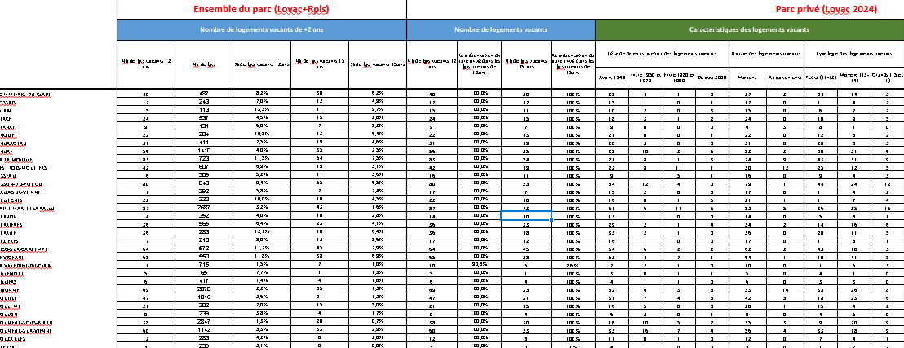
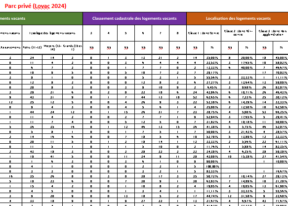
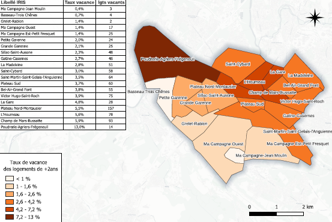
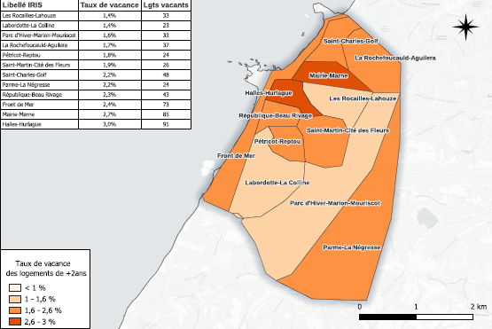
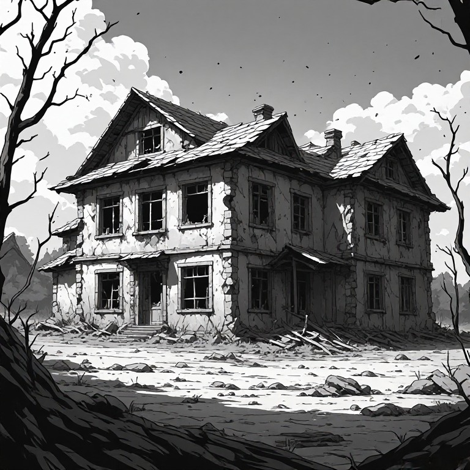
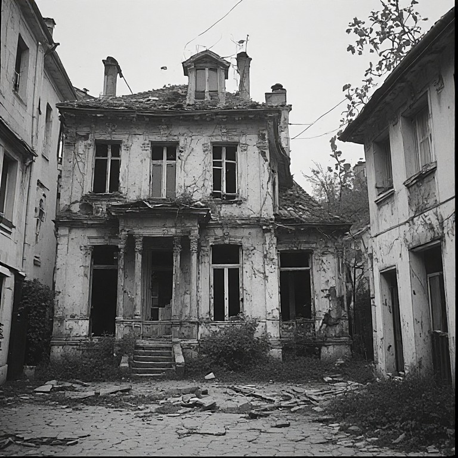
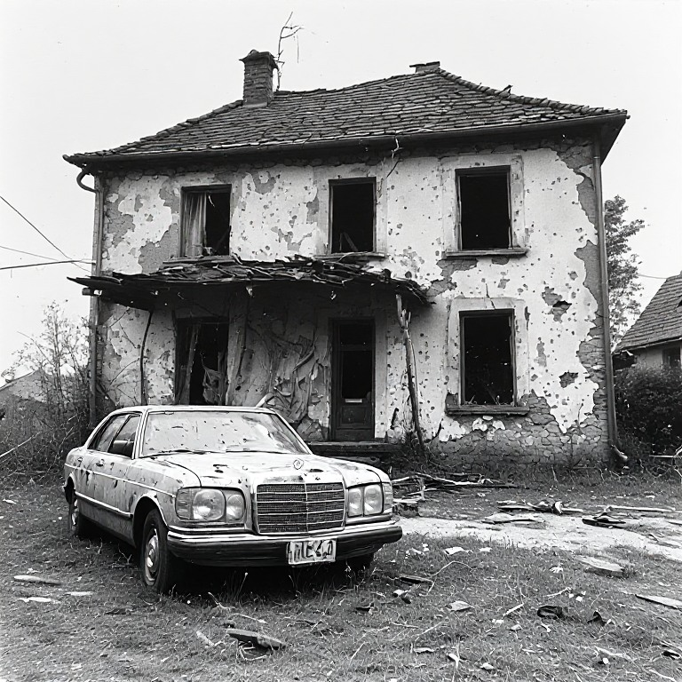
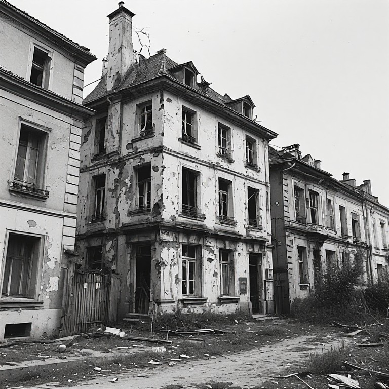

```{=html}
<style>
  p {
  text-align: inherit !important;
  }

.img-stack {
  position: relative;
  width: 100%;
  max-width: 900px;
  margin: auto;
  aspect-ratio: 3 / 1; /* hauteur fluide */
}

/* Images superposées */
.img-stack img {
  position: absolute;
  object-fit: contain;
  max-width: 100%;
  margin-top: -65px;
}

/* Image du dessus */
.img-top {
  width: 60%;
  right: 2%;
  top: 0;
}

/* Image du dessous */
.img-bottom {
  width: 40%;
  right: 35%;
  top: 15%;
}

/* --- Responsive fluide --- */
@media (max-width: 900px) {
  .img-top {
    width: 65%;
    right: 0;
    top: 5%;
  }
  .img-bottom {
    width: 45%;
    right: 30%;
    top: 20%;
  }
}

@media (max-width: 600px) {
  .img-top {
    width: 70%;
    right: 0;
    top: 10%;
  }
  .img-bottom {
    width: 50%;
    right: 25%;
    top: 25%;
  }
}

@media (max-width: 450px) {
  .img-top {
    width: 75%;
    right: 0;
    top: 15%;
  }
  .img-bottom {
    width: 55%;
    right: 20%;
    top: 30%;
  }
}

  
  .triple-overlap {
    position: relative;
    width: 100%;
    display: flex;
    justify-content: center; /* centre le groupe */
    align-items: center;
    text-align: center;
  }

  .triple-overlap img {
    width: 36%; /* taille des images */
  }

  /* Image de gauche */
  .img-left {
    position: relative;
    z-index: 1;
  }

  /* Image du milieu (au-dessus) */
  .img-middle {
    position: relative;
    z-index: 3; /* passe au-dessus */
    margin: 0 -6%; /* chevauchement horizontal */
    margin-top: -4%; /* chevauchement vertical */
  }

  /* Image de droite */
  .img-right {
    position: relative;
    z-index: 1;
  }

  /* Responsive */
  @media (max-width: 800px) {
    .triple-overlap img {
      width: 35%;
    }
    .img-middle {
      margin: 0 -8%;
      margin-top: -6%;
    }
  }

  @media (max-width: 500px) {
    .triple-overlap img {
      width: 45%;
    }
    .img-middle {
      margin: 0 -10%;
      margin-top: -8%;
    }
  }
</style>
```

## 1. Contexte et objet de l’étude

::::::::::: {style="font-family: YACkoD1yZN0-0;font-size:1.1em;"}
La vacance est un enjeu majeur du logement aujourd’hui largement pris en compte dans les politiques locales pour la production de logements, mais une vacance structurelle, longue (2 ans et plus) persiste souvent sur les territoires : elle n’est pas négligeable. Cette vacance est conséquente sur les villes moyennes hors littoral, les petites villes et dans la ruralité.

Dans un contexte général de nécessité de produire des logements dans l’existant afin de garantir une meilleure gestion économe du foncier, la résorption de la vacance s’impose ainsi toujours comme un enjeu majeur.

La présente **étude élaborée conjointement entre le Cerema et la DREAL Nouvelle Aquitaine** a vocation à présenter un état des lieux de la vacance sur la région Nouvelle-Aquitaine sur la base [**LOVAC**]{style="cursor:pointer; color: #42429f;" data-bs-toggle="tooltip" title="Voir annexes"} actualisée du Ministère des Finances, suite aux évolutions de cette dernière (mise en place d’une refonte du calcul avec l’outil «GMBI» Gestion de mon bien immobilier d’après la déclaration des propriétaires fonciers et évolution des méthodes de recensement). **L’étude présente la situation régionale** et les tendances d’évolution du phénomène puis propose un état des lieux fin et territorialisé de la vacance de **longue durée ces dernières années :**

::: {style="padding-left: 25px;"}
• **Des données sur les caractéristiques des logements à l’échelle [EPCI]{style="cursor:pointer; color:#42429f;" data-bs-toggle="tooltip" title="Etablissement public de coopération intercommunale"} et commune (la matrice : tableau type excel/cal)** avec les chiffres LOVAC de la vacance :
:::

::: {style="border: 1px solid; padding-left: 5px;"}
**Les caractéristiques des logements vacants présentés dans la matrice :** \
❖ nombre et part de logements vacants depuis plus de 2 ans,\
❖ durée de vacance,\
❖ typologie du parc (type de logement, année de construction)\
❖ localisation (à définir en lien avec le maître d’ouvrage)\
❖ qualité du bâti\
❖ ...
:::

::: img-stack
 
:::

::: {style="padding-left: 25px;"}
• **Une cartographie de la vacance pour 70 villes, à l’échelle des [quartiers]{style="cursor:pointer; color:#42429f;" data-bs-toggle="tooltip" title="liste des communes cartographiées dans la rubrique «Annexes : liste des communes cartographiées (IRIS)» "}**
:::

::: triple-overlap
  
:::

::: {style="padding-left: 25px;"}
• **Un recueil proposant une liste la plus exhaustive possible des outils et leviers existants pour lutter contre la vacance** (repérage, outils opérationnels, coercitifs, financiers…).

• un court guide court à destination des DDT/M dans leur dialogue à destination des élus (pourquoi lutter contre la vacance, quel type de vacance, quels outils et quelle démarche engager ?).
:::

Une 2e phase de l’étude présentera une analyse croisée de la vacance et du marché, des fiches par EPCI sur la vacance ainsi que des fiches de retours d’expériences.

::: {style="border:1px solid; padding:5px; background-color: antiquewhite;"}
<div style="color: #e68036;font-weight: bold;font-size: 1.15rem;">
  Une étude qui cible la vacance de longue durée, dite structurelle : définitions
</div>

<p>

La **vacance structurelle** correspond à une inoccupation qui se prolonge en raison d’obstacles à l’occupation ou à la remise sur le marché du logement. Ces obstacles peuvent tenir au bien lui-même — dégradation, travaux importants, caractéristiques inadaptées à la demande —, au contexte immobilier local — demande insuffisante notamment — ou à la situation du propriétaire : succession bloquée, difficultés financières, réticence à louer ou maintien volontaire du bien hors du marché. **Elle ne résulte donc pas seulement de la rotation ordinaire des occupants.** La notion de vacance strucurelle se rapproche de la notion de vacance de longue durée (plus de deux ans) qui est une catégorie définie par la **durée d’inoccupation**, plutôt que directement par ses causes. Dans LOVAC, le seuil de **plus de deux ans** est retenu pour repérer les logements du parc privé présumés relever de la vacance structurelle, notamment pour orienter les actions de remise sur le marché.

**Ce seuil constitue une convention de repérage, pas une frontière absolue** : un logement vacant depuis moins de deux ans peut déjà présenter des blocages structurels ; inversement, dépasser deux ans ne suffit pas à déterminer la cause de la vacance. Il est à noter que, dans les fichiers fiscaux, la vacance de plus de deux ans correspond à un logement identifié comme vacant **à au moins trois 1er janvier consécutifs.** Cette observation ne garantit pas l’absence de toute occupation entre ces dates dans LOVAC.

La **vacance frictionnelle**, ou **vacance de rotation**, correspond à l’inoccupation temporaire d’un logement entre deux occupants : départ d’un ménage, recherche d’un nouveau locataire ou acquéreur, vente, délai d’installation et éventuelle remise en état. Généralement de courte durée — quelques jours à quelques mois —, elle accompagne le fonctionnement du marché et la mobilité résidentielle. Elle ne traduit pas nécessairement une difficulté durable à remettre le logement en occupation.

</p>
:::

::: {.triple-overlap style="margin-top:10px;"}
  
:::
:::::::::::
