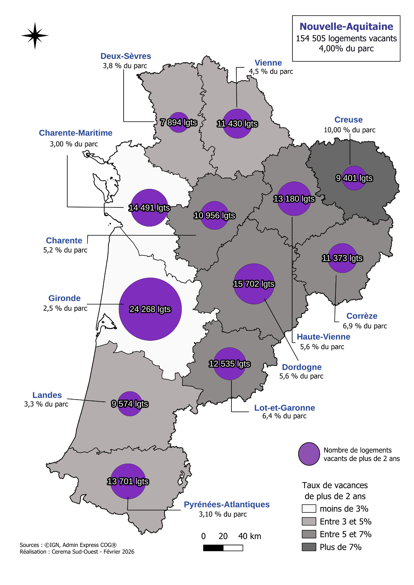
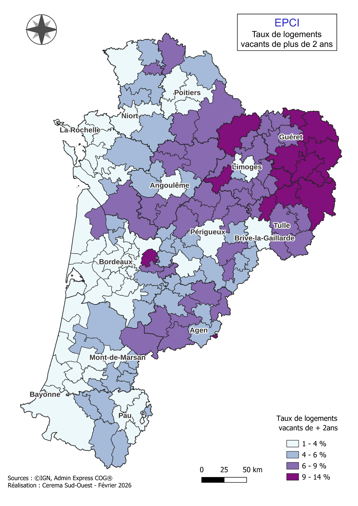
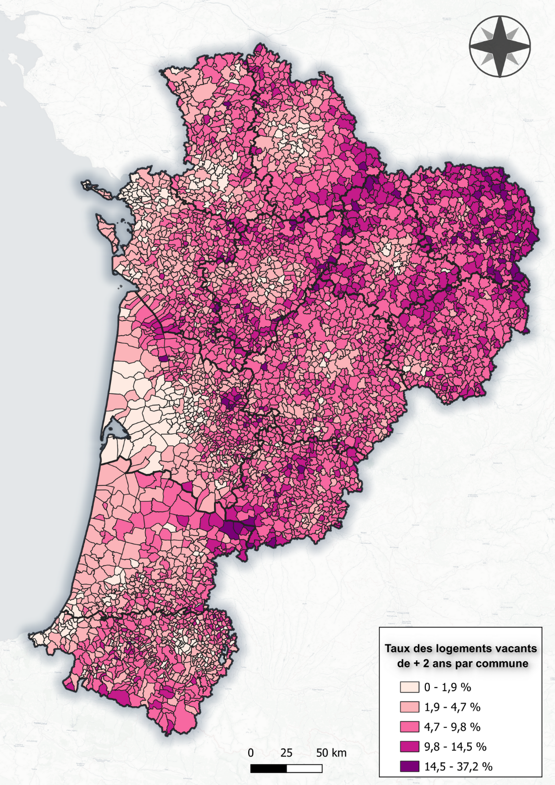
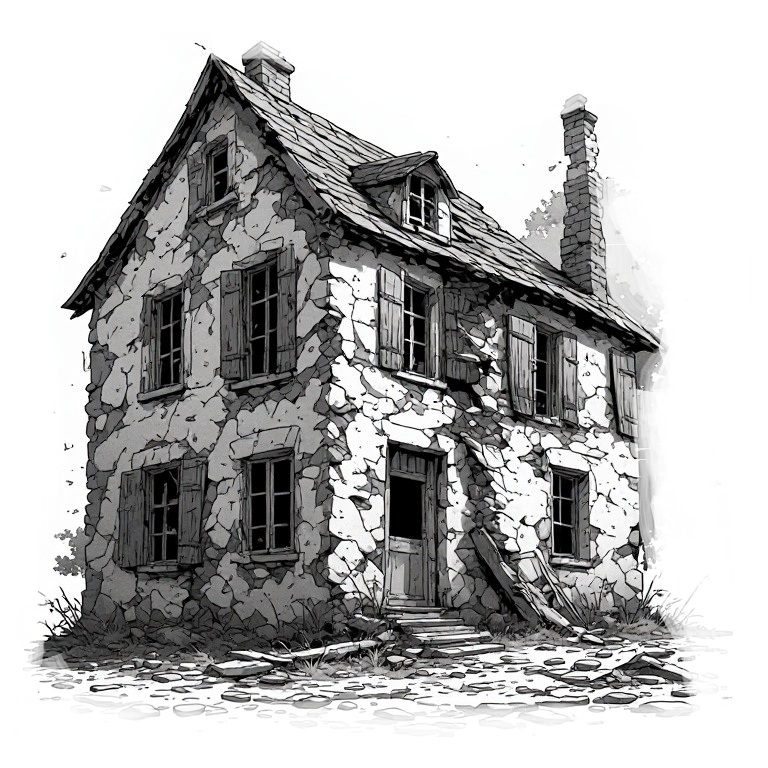

```{=html}
<style>
  p {
  text-align: inherit !important;
  }

.img-stack {
  position: relative;
  width: 100%;
  max-width: 900px;
  margin: auto;
  aspect-ratio: 3 / 1; /* hauteur fluide */
}

/* Images superposées */
.img-stack img {
  position: absolute;
  object-fit: contain;
  max-width: 100%;
  margin-top: -65px;
}

/* Image du dessus */
.img-top {
  width: 60%;
  right: 2%;
  top: 0;
}

/* Image du dessous */
.img-bottom {
  width: 40%;
  right: 35%;
  top: 15%;
}

/* --- Responsive fluide --- */
@media (max-width: 900px) {
  .img-top {
    width: 65%;
    right: 0;
    top: 5%;
  }
  .img-bottom {
    width: 45%;
    right: 30%;
    top: 20%;
  }
}

@media (max-width: 600px) {
  .img-top {
    width: 70%;
    right: 0;
    top: 10%;
  }
  .img-bottom {
    width: 50%;
    right: 25%;
    top: 25%;
  }
}

@media (max-width: 450px) {
  .img-top {
    width: 75%;
    right: 0;
    top: 15%;
  }
  .img-bottom {
    width: 55%;
    right: 20%;
    top: 30%;
  }
}

  
  .triple-overlap {
    position: relative;
    width: 100%;
    display: flex;
    justify-content: center; /* centre le groupe */
    align-items: center;
    text-align: center;
  }

  .triple-overlap img {
    width: 36%; /* taille des images */
  }

  /* Image de gauche */
  .img-left {
    position: relative;
    z-index: 1;
  }

  /* Image du milieu (au-dessus) */
  .img-middle {
    position: relative;
    z-index: 3; /* passe au-dessus */
    margin: 0 -6%; /* chevauchement horizontal */
    margin-top: -4%; /* chevauchement vertical */
  }

  /* Image de droite */
  .img-right {
    position: relative;
    z-index: 1;
  }

  /* Responsive */
  @media (max-width: 800px) {
    .triple-overlap img {
      width: 35%;
    }
    .img-middle {
      margin: 0 -8%;
      margin-top: -6%;
    }
  }

  @media (max-width: 500px) {
    .triple-overlap img {
      width: 45%;
    }
    .img-middle {
      margin: 0 -10%;
      margin-top: -8%;
    }
  }
</style>
```

## 3. Etat des lieux de la vacance : cartographie

::: {style="font-family: YACkoD1yZN0-0;font-size:1.1em;"}
Selon les données LOVAC, la vacance des logements en Nouvelle-Aquitaine est estimée à 9,5 %, soit environ 340 000 logements. Une partie de ces logements n’est inoccupée que temporairement, notamment entre deux occupants ou à l’occasion de travaux de remise en état.

Cette vacance conjoncturelle accompagne la rotation des ménages et l’entretien du parc, contribuant ainsi à la fluidité des parcours résidentiels.

La présente étude se concentre sur la vacance de longue durée, définie ici comme une inoccupation depuis au moins deux ans et retenue comme indicateur de la vacance structurelle.

L’objectif est de repérer les logements durablement inoccupés pour lesquels les acteurs locaux peuvent engager des actions visant à favoriser leur remise sur le marché.

En Nouvelle-Aquitaine, au 1er janvier 2024, **cette vacance de longue durée concerne environ 154 505 logements, soit 4 % du parc de logements.**

Sa répartition départementale, établie à partir des bases de données [LOVAC]{style="cursor:pointer; color: #42429f;" data-bs-toggle="tooltip" title="LOVAC : voir annexe"} pour le parc privé et [RPLS]{style="cursor:pointer; color: #42429f;" data-bs-toggle="tooltip" title="RPLS : Le RPLS (Répertoire des logements locatifs des bailleurs sociaux) est une base statistique actualisée chaque année qui décrit, au 1er janvier, le parc locatif des bailleurs sociaux, notamment les caractéristiques des logements, leurs loyers et leur situation d’occupation ou de vacance.  "} pour le parc social est présentée ci-après.

```{=html}
<!DOCTYPE html>
<html lang="fr">
<head>
  <meta charset="UTF-8" />
  <meta name="viewport" content="width=device-width, initial-scale=1.0" />
  <title>Évolution Nouvelle-Aquitaine 2020–2024</title>
  <style>
    *, *::before, *::after { box-sizing: border-box; margin: 0; padding: 0; }
    body { font-family: system-ui, sans-serif; background: #f9f9f7; color: #1a1a18; padding: 2rem 1rem; }
    .controls { display: flex; gap: 12px; align-items: center; margin-bottom: 1rem; flex-wrap: wrap; }
    input[type="text"] { flex: 1; min-width: 160px; padding: 8px 12px; border: 0.5px solid #ccc; border-radius: 8px; font-size: 14px; background: #fff; }
    select { padding: 8px 12px; border: 0.5px solid #ccc; border-radius: 8px; font-size: 14px; background: #fff; cursor: pointer; }
    .table-wrap { overflow-x: auto; border: 0.5px solid #e0dfd8; border-radius: 12px; background: #fff; }
    table { width: 100%; border-collapse: collapse; font-size: 14px; table-layout: fixed; }
    thead tr { background: #f1efe8; }
    th { padding: 10px 14px; text-align: left; font-weight: 500; font-size: 13px; color: #5f5e5a; border-bottom: 0.5px solid #e0dfd8; cursor: pointer; user-select: none; white-space: nowrap; }
    th:hover { color: #1a1a18; }
    td { padding: 9px 14px; border-bottom: 0.5px solid #e0dfd8; color: #1a1a18; }
    tr:last-child td { border-bottom: none; }
    tr.total-row td { font-weight: 500; background: #f1efe8; }
    tr:hover:not(.total-row) td { background: #f9f9f7; }
    .badge3 { display: inline-flex; align-items: center; padding: 2px 8px; border-radius: 20px; font-size: 12px; font-weight: 500; }
    .badge3.pos { background: #ddffdd; color: #1a5c1a; }
    .badge3.neg { background: #ffdddd; color: #7a1a1a; }
    .bar-bg { width: 100%; height: 6px; background: #e0dfd8; border-radius: 4px; overflow: hidden; position: relative; }
    .metrics { display: grid; grid-template-columns: repeat(auto-fit, minmax(130px, 1fr)); gap: 10px; margin-bottom: 1rem; }
    .metric { background: #f1efe8; border-radius: 8px; padding: 0.75rem 1rem; }
    .metric-label { font-size: 12px; color: #5f5e5a; margin-bottom: 4px; }
    .metric-value { font-size: 20px; font-weight: 500; }
    .metric-sub { font-size: 11px; color: #888780; margin-top: 2px; }
  </style>
</head>
<body>

<div class="container4">
  <h5 style="text-align:center;">Logements vacants (+2 ans) — Nouvelle-Aquitaine</h5>

  <div class="metrics4" id="metrics4"></div>

  <div class="controls4">
    <input type="text" placeholder="Rechercher un département…" id="search4" oninput="render4()" />
    <select id="sort-col4" onchange="render4()">
      <option value="dep">Département</option>
      <option value="nb">Nb. vacants</option>
      <option value="taux">Taux (%)</option>
      <option value="part">Répartition (%)</option>
    </select>
    <select id="sort-dir4" onchange="render4()">
      <option value="asc">↑ Croissant</option>
      <option value="desc">↓ Décroissant</option>
    </select>
  </div>

  <div class="table-wrap4">
    <table class="table4">
  <thead>
<tr>
  <th onclick="sortBy4('dep')">Département</th>
  <th onclick="sortBy4('nb')" style="text-align:right">Nb. vacants</th>
  <th onclick="sortBy4('taux')" style="text-align:right">Taux</th>
  <th onclick="sortBy4('part')" style="text-align:right">Répartition</th>
  <th style="width:30%">Evolution</th>
</tr>
  </thead>
  <tbody id="tbody4"></tbody>
</table>
  </div>
</div>

<style>
  .container4 { max-width: 900px; margin:20px 0 40px;}
  .controls4 { display: flex; gap: 12px; margin-bottom: 1rem; flex-wrap: wrap; }
  .table-wrap4 { overflow-x: auto; border: 0.5px solid #e0dfd8; border-radius: 12px; background: #fff; }
  .table4 { width: 100%; border-collapse: collapse; font-size: 14px; }
  .table4 th, .table4 td { padding: 9px 14px; border-bottom: 0.5px solid #e0dfd8; }
  .table4 th { background: #f1efe8; cursor: pointer; }
  .table4 tr.total-row4 td { font-weight: 600; background: #f1efe8; }
  .table4 tr:hover:not(.total-row4) td { background: #f9f9f7; }

  .metrics4 { display: grid; grid-template-columns: repeat(auto-fit, minmax(130px, 1fr)); gap: 10px; margin-bottom: 1rem; }
  .metric4 { background: #f1efe8; border-radius: 8px; padding: 0.75rem 1rem; }
  .metric4-label { font-size: 12px; color: #5f5e5a; margin-bottom: 4px; }
  .metric4-value { font-size: 20px; font-weight: 500; }
  .metric4-sub { font-size: 11px; color: #888780; margin-top: 2px; }

  .badge4 { padding: 2px 8px; border-radius: 20px; font-size: 12px; font-weight: 500; }
  .badge4.pos { background:#ddffdd; color:#1a5c1a; }
  .badge4.neg { background:#ffdddd; color:#7a1a1a; }

  .bar-bg4 { width:100%; height:6px; background:#e0dfd8; border-radius:4px; position:relative; overflow:hidden; }
  .bar4 { height:100%; background:#2d8a4e; border-radius:4px; }
</style>

<script>
// --- Données du tableau 4 ---
const raw4 = [
  {dep:"Charente", nb:10956, taux:5.20, part:7.09},
  {dep:"Charente-Maritime", nb:14491, taux:3.00, part:9.38},
  {dep:"Corrèze", nb:11373, taux:6.90, part:7.36},
  {dep:"Creuse", nb:9401, taux:10.00, part:6.08},
  {dep:"Dordogne", nb:15702, taux:5.60, part:10.16},
  {dep:"Gironde", nb:24268, taux:2.50, part:15.71},
  {dep:"Landes", nb:9574, taux:3.30, part:6.20},
  {dep:"Lot-et-Garonne", nb:12535, taux:6.40, part:8.11},
  {dep:"Pyrénées-Atlantiques", nb:13701, taux:3.90, part:8.86},
  {dep:"Deux-Sèvres", nb:7894, taux:3.80, part:5.11},
  {dep:"Vienne", nb:11430, taux:4.50, part:7.40},
  {dep:"Haute-Vienne", nb:13180, taux:5.60, part:8.53},
];

const total4 = { dep:"Nouvelle-Aquitaine", nb:154505, taux:4.00, part:100.00 };

let currentSort4 = "dep";
let currentDir4 = "asc";

function sortBy4(col) {
  if (currentSort4 === col) currentDir4 = currentDir4 === "asc" ? "desc" : "asc";
  else { currentSort4 = col; currentDir4 = "asc"; }
  document.getElementById("sort-col4").value = col;
  document.getElementById("sort-dir4").value = currentDir4;
  render4();
}

function render4() {
  const q   = document.getElementById("search4").value.toLowerCase();
  const col = document.getElementById("sort-col4").value;
  const dir = document.getElementById("sort-dir4").value;

  let rows = raw4.filter(r => r.dep.toLowerCase().includes(q));

  rows.sort((a,b) => {
    if (col === "dep") return dir === "asc"
      ? a.dep.localeCompare(b.dep, "fr")
      : b.dep.localeCompare(a.dep, "fr");
    return dir === "asc" ? a[col] - b[col] : b[col] - a[col];
  });

  const maxPart = Math.max(...rows.map(r => r.part));

  const tbody = document.getElementById("tbody4");
  tbody.innerHTML = rows.map(r => `
    <tr>
      <td>${r.dep}</td>
      <td style="text-align:right">${r.nb.toLocaleString("fr-FR")}</td>
      <td style="text-align:right">${r.taux.toFixed(2)}%</td>
      <td style="text-align:right">
        <span class="badge4 pos">${r.part.toFixed(2)}%</span>
      </td>
      <td>
        <div class="bar-bg4">
          <div class="bar4" style="width:${(r.part/maxPart)*100}%"></div>
        </div>
      </td>
    </tr>
  `).join("");

  // TOTAL
  tbody.innerHTML += `
    <tr class="total-row4">
      <td>${total4.dep}</td>
      <td style="text-align:right">${total4.nb.toLocaleString("fr-FR")}</td>
      <td style="text-align:right">${total4.taux.toFixed(2)}%</td>
      <td style="text-align:right"><span class="badge4 pos">100.00%</span></td>
      <td></td>
    </tr>
  `;

  renderMetrics4(rows);
}

function renderMetrics4(rows) {
  const maxVac = [...rows].sort((a,b)=>b.nb-a.nb)[0];
  const maxTaux = [...rows].sort((a,b)=>b.taux-a.taux)[0];
  const maxPart = [...rows].sort((a,b)=>b.part-a.part)[0];

  document.getElementById("metrics4").innerHTML = `
    <div class="metric4">
      <div class="metric4-label">Total logements vacants</div>
      <div class="metric4-value">${total4.nb.toLocaleString("fr-FR")}</div>
      <div class="metric4-sub">${total4.dep}</div>
    </div>

    <div class="metric4">
      <div class="metric4-label">Plus grand nombre</div>
      <div class="metric4-value">${maxVac.nb.toLocaleString("fr-FR")}</div>
      <div class="metric4-sub">${maxVac.dep}</div>
    </div>

    <div class="metric4">
      <div class="metric4-label">Taux le plus élevé</div>
      <div class="metric4-value">${maxTaux.taux.toFixed(2)}%</div>
      <div class="metric4-sub">${maxTaux.dep}</div>
    </div>

    <div class="metric4">
      <div class="metric4-label">Plus forte répartition</div>
      <div class="metric4-value">${maxPart.part.toFixed(2)}%</div>
      <div class="metric4-sub">${maxPart.dep}</div>
    </div>
  `;
}

render4();
</script>
```

<div style="text-align: center !important;">

{.lightbox style="width:62%;"}

</div>

Cette ne mesure pas l’évolution de la vacance **mais confirme clairement la tendance à une vacance installée qui plus importante dans les départements de l’Est (+ de 5 % de logements vacants -longue durée-), et a contrario plus faible sur le littoral. La carte suivante de la vacance par EPCI confirme cette une vacance plus importante sur les EPCI de l’Est de la région.**
:::

### 3.1 La vacance par EPCI

:::: {style="font-family: YACkoD1yZN0-0;font-size:1.1em;"}
<div style="text-align: center !important;">

{.lightbox style="width:62%;"}

</div>

::: {style="border: 1px solid; padding:5px;"}
La carte met en évidence un **contraste ouest–est marqué** de la vacance de plus de deux ans. Les taux sont généralement plus faibles sur le littoral et dans les intercommunalités des principaux pôles urbains, où ils se situent souvent entre **1 et 4 %.**

À l’inverse, les niveaux les plus élevés, compris entre **9 et 14 %**, se concentrent surtout dans le nord-est et l’est de la région, notamment dans la Creuse et l’est de la Corrèze. De nombreux territoires intérieurs présentent également des taux élevés, entre **6 et 9 %.**

Cette répartition reste toutefois contrastée : les intercommunalités de Limoges, de Périgueux ou d’Angoulême affichent des taux plus faibles que plusieurs des territoires qui les entourent.
:::
::::

### 3.2 La vacance par commune

::::: {style="font-family: YACkoD1yZN0-0;font-size:1.1em;"}
<div style="text-align: center !important;">

{.lightbox style="width:62%;"}

</div>

::: {style="border:1px solid; padding:5px;margin-bottom:10px;"}
À l’échelle communale, la carte confirme des **taux de vacance de plus de deux ans généralement plus faibles sur le littoral et autour des principaux pôles urbains**, souvent inférieurs à **4,7 %**. Les taux supérieurs à **9,8 %** se concentrent davantage dans le nord-est et certains territoires intérieurs, mais des poches de vacance élevée apparaissent également dans le centre et le sud de la région.
:::

Certaines communes relèvent ainsi de la classe la plus élevée, comprise entre **14,5 et 37,2 %.** Cette représentation révèle surtout une **forte hétérogénéité entre communes voisines**, que les moyennes intercommunales atténuent, et souligne l’intérêt d’une analyse locale pour préciser les secteurs les plus concernés.

**Les données ayant permis de réaliser cette carte, disponible dans la matrice**, mettent en évidence plusieurs situations de vacance particulièrement marquées. Certaines villes moyennes cumulent des taux élevés et des volumes importants de logements durablement vacants, comme Aubusson ou Tulle.

Dans plusieurs de ces territoires, une part importante de cette vacance est ancienne, avec des taux de vacance de plus de cinq ans atteignant des taux important.

Quelques petites communes affichent des niveaux extrêmement élevés — par exemple Bousses : 37,2 %, Saint-Antoine-du-Queyret : 29,2 %, Saint-Georges : 27,9 % ou Saint-Pierre-le-Bost : 26 % — mais ces taux portent parfois sur seulement quelques dizaines de logements. Ils signalent néanmoins une vacance très profondément installée, particulièrement lorsque le taux à plus de cinq ans reste lui aussi élevé : 34,9 % à Bousses, 25,6 % à Saint-Georges, 21,1 % à Saint-Pierre-le-Bost.

À l’inverse, les principaux pôles urbains peuvent présenter des stocks importants en valeur absolue, mais des taux nettement plus faibles. Cette distinction entre volume et taux est essentielle pour identifier les territoires où la vacance constitue un phénomène réellement structurel. Bordeaux compte **4 740 logements vacants depuis plus de deux ans**, mais ceux-ci ne représentent que **2,6 % du parc** ; Limoges en compte **3 206**, soit **3,7 %** ; Pau **1 768**, soit **3,2 %** ; Poitiers **1 502**, soit **2,6 %.** Cela montre que le nombre brut de logements vacants ne suffit pas à qualifier la gravité d’une situation.

→ **Une cartographie de 70 communes (métropole, agglomérations et petites villes) est disponible dans** <a href="iris.html">cet onglet</a>. Elle présente la vacance par quartier IRIS et les variations au sein d’une même commune (nombre et % de logements vacants).

```{=html}
<div style="border:1px solid; padding:10px; display:flex; gap:20px; align-items:flex-start;" class="vacance_maison">
  <div style="flex:1;">
    <p><strong>Des situations particulièrement marquées :</strong></p>
    <p>
      L'analyse communale fait apparaître plusieurs situations de vacance structurelle conséquente.
      En ne retenant que les communes comptant au moins 100 logements vacants depuis plus de deux ans,
      une vingtaine de territoires présentent des taux supérieurs à 10 %. Certaines communes cumulent
      un taux élevé et un stock conséquent, notamment Aubusson (494 logements ; 15,6 %),
      Bort-les-Orgues (362 ; 16,2 %), Tulle (1 139 ; 11,1 %) ou Fumel (319 ; 10,4 %).
      La durée de vacance constitue un indicateur supplémentaire de fragilité : dans plusieurs communes,
      plus de 60 % des logements vacants depuis deux ans le sont déjà depuis plus de cinq ans.
      Ces situations traduisent une vacance profondément installée, qui dépasse largement les phénomènes
      de rotation du marché.
    </p>
    <p>Voir tableau suivant, extrait de la matrice réalisée par le CEREMA.</p>
  </div>
  <div style="flex:0 0 250px;">
    
  </div>
</div>

<style>
@media (max-width:1100px){
  .vacance_maison{
  display:block !important;
  }
}
</style>
<br>
```

::: {style="text-align: center !important;"}
**communes présentant les situations de vacance longue les plus marquées**\
Sélection : au moins 100 logements vacants depuis plus de 2 ans – LOVAC 2024
:::

```{=html}
<style>
  table.vacance-table {
    width: 100%;
    border-collapse: collapse;
    font-size: 15px;
  }

  /* Ligne d’en‑tête gris foncé */
  table.vacance-table thead tr {
    background: #444;
    color: white;
  }

  table.vacance-table th,
  table.vacance-table td {
    padding: 8px 12px;
    border: 1px solid #ddd;
    text-align: center;
  }
  
  /* Autoriser le retour à la ligne dans les en-têtes */
  table.vacance-table th {
    white-space: normal;
    word-break: break-word;
    vertical-align:middle;
  }
  
  /* Option : élargir légèrement la colonne problématique */
  table.vacance-table th:nth-child(6) {
    min-width: 160px;
  }


  /* Alternance gris clair / blanc */
  table.vacance-table tbody tr:nth-child(odd) {
    background: #f7f7f7;   /* gris très clair */
  }

  table.vacance-table tbody tr:nth-child(even) {
    background: #ffffff;   /* blanc */
  }
</style>

<table class="vacance-table">
  <thead>
    <tr>
      <th>Commune</th>
      <th>Vacants +2 ans</th>
      <th>Taux +2 ans</th>
      <th>Vacants +5 ans</th>
      <th>Taux +5 ans</th>
      <th>Part des +5 ans parmi les +2 ans</th>
    </tr>
  </thead>

  <tbody>
    <tr><td>Saint-Émilion</td><td>218</td><td>17,1 %</td><td>149</td><td>11,7 %</td><td>68 %</td></tr>
    <tr><td>Bort-les-Orgues</td><td>362</td><td>16,2 %</td><td>173</td><td>7,7 %</td><td>48 %</td></tr>
    <tr><td>Aubusson</td><td>494</td><td>15,6 %</td><td>278</td><td>8,8 %</td><td>56 %</td></tr>
    <tr><td>Auzances</td><td>125</td><td>14,0 %</td><td>80</td><td>9,0 %</td><td>64 %</td></tr>
    <tr><td>Bourganeuf</td><td>237</td><td>13,5 %</td><td>161</td><td>9,1 %</td><td>68 %</td></tr>
    <tr><td>Eymoutiers</td><td>202</td><td>12,6 %</td><td>141</td><td>8,8 %</td><td>70 %</td></tr>
    <tr><td>Montagne</td><td>116</td><td>12,4 %</td><td>79</td><td>8,4 %</td><td>68 %</td></tr>
    <tr><td>Châlus</td><td>155</td><td>12,2 %</td><td>114</td><td>9,0 %</td><td>74 %</td></tr>
    <tr><td>Boussac</td><td>117</td><td>12,0 %</td><td>78</td><td>8,0 %</td><td>67 %</td></tr>
    <tr><td>Lathus-Saint-Rémy</td><td>117</td><td>12,0 %</td><td>76</td><td>7,8 %</td><td>65 %</td></tr>
    <tr><td>Sainte-Foy-la-Grande</td><td>226</td><td>11,9 %</td><td>116</td><td>6,1 %</td><td>51 %</td></tr>
    <tr><td>Saint-Laurent-sur-Gorre</td><td>113</td><td>11,9 %</td><td>52</td><td>5,5 %</td><td>46 %</td></tr>
    <tr><td>Bussière-Poitevine</td><td>198</td><td>11,8 %</td><td>127</td><td>7,6 %</td><td>64 %</td></tr>
    <tr><td>Mézin</td><td>118</td><td>11,8 %</td><td>63</td><td>6,3 %</td><td>53 %</td></tr>
    <tr><td>Uzerche</td><td>210</td><td>11,6 %</td><td>132</td><td>7,3 %</td><td>63 %</td></tr>
    <tr><td>Chalais</td><td>147</td><td>11,6 %</td><td>93</td><td>7,4 %</td><td>63 %</td></tr>
    <tr><td>Corrèze</td><td>102</td><td>11,3 %</td><td>65</td><td>7,2 %</td><td>64 %</td></tr>
    <tr><td>Tulle</td><td>1 139</td><td>11,1 %</td><td>691</td><td>6,7 %</td><td>61 %</td></tr>
    <tr><td>Le Dorat</td><td>132</td><td>11,1 %</td><td>70</td><td>5,9 %</td><td>53 %</td></tr>
    <tr><td>Lubersac</td><td>166</td><td>10,6 %</td><td>105</td><td>6,7 %</td><td>63 %</td></tr>
    <tr><td>Fumel</td><td>319</td><td>10,4 %</td><td>184</td><td>6,0 %</td><td>58 %</td></tr>
  </tbody>
</table>

<div style="font-size:0.8em; color:gray;">
Lecture : la dernière colonne mesure la proportion des logements vacants depuis plus de 5 ans parmi ceux vacants depuis plus de 2 ans.
</div>
```
:::::

