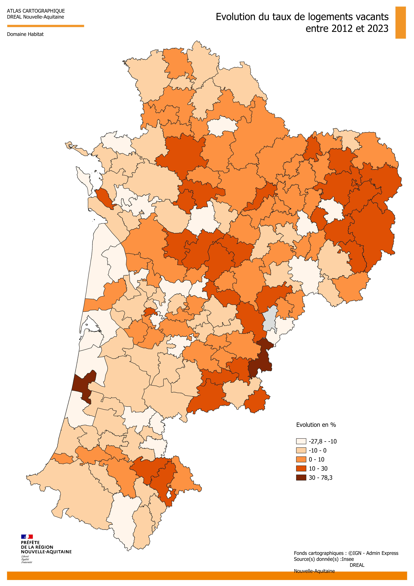

```{=html}
<style>
  p {
  text-align: inherit !important;
  }

.img-stack {
  position: relative;
  width: 100%;
  max-width: 900px;
  margin: auto;
  aspect-ratio: 3 / 1; /* hauteur fluide */
}

/* Images superposées */
.img-stack img {
  position: absolute;
  object-fit: contain;
  max-width: 100%;
  margin-top: -65px;
}

/* Image du dessus */
.img-top {
  width: 60%;
  right: 2%;
  top: 0;
}

/* Image du dessous */
.img-bottom {
  width: 40%;
  right: 35%;
  top: 15%;
}

/* --- Responsive fluide --- */
@media (max-width: 900px) {
  .img-top {
    width: 65%;
    right: 0;
    top: 5%;
  }
  .img-bottom {
    width: 45%;
    right: 30%;
    top: 20%;
  }
}

@media (max-width: 600px) {
  .img-top {
    width: 70%;
    right: 0;
    top: 10%;
  }
  .img-bottom {
    width: 50%;
    right: 25%;
    top: 25%;
  }
}

@media (max-width: 450px) {
  .img-top {
    width: 75%;
    right: 0;
    top: 15%;
  }
  .img-bottom {
    width: 55%;
    right: 20%;
    top: 30%;
  }
}

  
  .triple-overlap {
    position: relative;
    width: 100%;
    display: flex;
    justify-content: center; /* centre le groupe */
    align-items: center;
    text-align: center;
  }

  .triple-overlap img {
    width: 36%; /* taille des images */
  }

  /* Image de gauche */
  .img-left {
    position: relative;
    z-index: 1;
  }

  /* Image du milieu (au-dessus) */
  .img-middle {
    position: relative;
    z-index: 3; /* passe au-dessus */
    margin: 0 -6%; /* chevauchement horizontal */
    margin-top: -4%; /* chevauchement vertical */
  }

  /* Image de droite */
  .img-right {
    position: relative;
    z-index: 1;
  }

  /* Responsive */
  @media (max-width: 800px) {
    .triple-overlap img {
      width: 35%;
    }
    .img-middle {
      margin: 0 -8%;
      margin-top: -6%;
    }
  }

  @media (max-width: 500px) {
    .triple-overlap img {
      width: 45%;
    }
    .img-middle {
      margin: 0 -10%;
      margin-top: -8%;
    }
  }
</style>
```

## 2. L’évolution de la vacance globale des logements

### 2.1 Précautions méthodologiques

::: {style="font-family: YACkoD1yZN0-0;font-size:1.1em;"}
Deux sources complémentaires sont mobilisées dans cette étude : les données du recensement de la population de l’Insee pour analyser l’évolution de la vacance totale, et les données [**LOVAC**]{style="cursor:pointer; color: #42429f;" data-bs-toggle="tooltip" title="Voir annexes"} pour caractériser la vacance du parc privé à un millésime donné. Des travaux locaux peuvent compléter cette approche, notamment par le croisement de sources et la vérification des situations sur le terrain. Le recensement INSEE ne renseigne toutefois pas la durée d’inoccupation : il ne permet donc pas, à lui seul, de distinguer la vacance de rotation des situations durablement bloquées.

**Les comparaisons brutes entre les millésimes LOVAC traversant les ruptures de série ne sont pas pertinentes pour mesurer l’évolution de la [vacance]{style="cursor:pointer; color: #42429f;" data-bs-toggle="tooltip" title="Les données LOVAC mettent en évidence l’ampleur de la vacance de longue durée dans le parc privé : le millésime 2024 identifie environ 1,15 million de logements vacants depuis plus de deux ans à l’échelle nationale, et le millésime 2025 environ 1,35 million. Ces dénombrements ne peuvent toutefois pas être interprétés directement comme une augmentation réelle de la vacance, en raison des ruptures de série liées au passage à GMBI puis aux modifications de traitement intervenues en 2025. Cette réserve concerne aussi bien l’échelle nationale que les échelles locales. Les données permettent de caractériser un stock important de logements identifiés comme durablement vacants, mais leur comparaison brute ne permet pas d’en établir l’évolution (ni avec des millésimes antérieurs, 2023, 2022, 2021, 2020) pour des raisons de ruptures de méthode également."}**. Le passage aux déclarations d’occupation GMBI à partir du millésime 2024, puis les modifications de sélection des logements intervenues en 2025, affectent leur comparabilité. Cette réserve concerne aussi bien l’échelle nationale que les échelles locales.

**Le recensement constitue ainsi la principale référence commune retenue ici pour l’analyse des tendances.** Ses résultats doivent néanmoins être interprétés en tenant compte des évolutions de la [**collecte**]{style="cursor:pointer; color: #42429f;" data-bs-toggle="tooltip" title="En particulier, le protocole « boîte aux lettres », généralisé en 2022, a un effet sur la répartition entre résidences principales et logements vacants, progressivement intégré aux résultats. Les variations récentes ne peuvent donc pas être attribuées intégralement à des évolutions du marché du logement."}.
:::

### 2.2 En Nouvelle-Aquitaine : une forte hausse de la vacance entre 2006 et 2016, suivie d’une quasi-stabilisation de 2016 à 2022

:::: {style="font-family: YACkoD1yZN0-0;font-size:1.1em;"}
D’après les données du recensement, le nombre de logements vacants en Nouvelle-Aquitaine fluctue autour de 200 000 entre 1982 et 2006. Leur part dans l’ensemble du parc diminue sur cette période, passant de **8,73 % à 6,61 %.** Entre **2006 et 2016**, leur nombre augmente fortement, de **201 472 à 294 627**, et leur part atteint **8,54 %.**

Entre **2016 et 2022**, le nombre de logements vacants se stabilise presque : il augmente de **0,8 %**, pour atteindre **296 999 logements**, alors que l’ensemble du parc progresse de **6,2 %**. Le taux de vacance mesuré diminue donc de **0,43 point**, à **8,11 %.** Sur l’ensemble de la période **2006–2022**, les effectifs restent cependant en hausse de **47,4 %**, et le taux supérieur d’environ **1,5 point** à son niveau de 2006.

La tendance régionale se traduit donc par une hausse importante au cours de la décennie 2006–2016 puis une quasi-stabilisation des effectifs et un recul de leur part entre 2016 et 2022.

::: {style="text-align:center; font-weight:bold;"}
Évolution du nombre de logements par catégorie en historique pour la Nouvelle-Aquitaine
:::

```{=html}
<style>
  /* --- Wrapper pour scroll horizontal fluide --- */
.table-wrapper {
  overflow-x: auto;
  overflow-y: hidden;
  -webkit-overflow-scrolling: touch;
  width: 100%;
}

/* --- Tableau --- */
table.parc-logements {
  width: 100%;
  border-collapse: collapse;
  font-size: 15px;
  min-width: 1100px; /* empêche la compression excessive */
}

/* En-tête gris foncé */
table.parc-logements thead tr {
  background: #444;
  color: white;
}

/* Cellules */
table.parc-logements th,
table.parc-logements td {
  padding: 8px 12px;
  border: 1px solid #ddd;
  text-align: left;

  /* Empêche le débordement */
  white-space: normal;
  word-break: break-word;

  /* Empêche la disparition des colonnes */
  min-width: 90px;
}

/* Alternance gris clair / blanc */
table.parc-logements tbody tr:nth-child(odd) {
  background: #f7f7f7;
}
table.parc-logements tbody tr:nth-child(even) {
  background: #ffffff;
}

/* --- Mobile : texte légèrement plus petit --- */
@media (max-width: 600px) {
  table.parc-logements {
    font-size: 14px;
  }
}
</style>

<div class="table-wrapper">
<table class="parc-logements">
  <thead>
    <tr>
      <th>Catégorie de logement</th>
      <th>1968</th><th>1975</th><th>1982</th><th>1990</th>
      <th>1999</th><th>2006</th><th>2011</th><th>2016</th><th>2022</th>
    </tr>
  </thead>

  <tbody>
    <tr>
      <td><strong>Ensemble Nouvelle Aquitaine</strong></td>
      <td>1 716 457</td><td>1 954 084</td><td>2 220 304</td><td>2 488 926</td>
      <td>2 742 006</td><td>3 045 767</td><td>3 255 884</td><td>3 451 872</td><td>3 664 327</td>
    </tr>

    <tr>
      <td>Résidences principales</td>
      <td>1 442 524</td><td>1 596 260</td><td>1 787 373</td><td>1 975 871</td>
      <td>2 210 131</td><td>2 459 921</td><td>2 610 999</td><td>2 742 949</td><td>2 922 921</td>
    </tr>

    <tr>
      <td>Résidences secondaires</td>
      <td>135 247</td><td>183 573</td><td>239 154</td><td>310 604</td>
      <td>336 075</td><td>384 373</td><td>388 078</td><td>414 296</td><td>444 406</td>
    </tr>

    <tr>
      <td>Logements vacants</td>
      <td>138 686</td><td>174 251</td><td>193 777</td><td>202 451</td>
      <td>195 800</td><td>201 472</td><td>256 807</td><td>294 627</td><td>296 999</td>
    </tr>

    <tr>
      <td>Part des logements vacants dans l’ensemble du parc</td>
      <td>8,08 %</td><td>8,92 %</td><td>8,73 %</td><td>8,13 %</td>
      <td>7,14 %</td><td>6,61 %</td><td>7,89 %</td><td>8,54 %</td><td>8,11 %</td>
    </tr>
  </tbody>
</table>
</div>

<div style="font-size:0.8em; color:gray;">
Les données proposées sont établies à périmètre géographique identique, dans la géographie en vigueur au 01/01/2025.
Sources : Insee, RP1967 au RP1999 dénombrements, RP2006 au RP2022 exploitations principales.
</div>
```

```{=html}
<div style="text-align:center; font-weight:bold; margin-top:20px;margin-bottom:10px;">
Détail du tableau, logements vacants en Nouvelle-Aquitaine :
</div>

<table id="parc-logements">
  <thead>
    <tr>
      <th>Année</th>
      <th style="text-align:center;">Logements vacants</th>
      <th style="text-align:center;">Part du parc total</th>
    </tr>
  </thead>
  
  <tbody>
    <tr>
      <td><strong>2006</strong></td>
      <td style="text-align:center;">201 472</td>
      <td style="text-align:center;">6,61 %</td>
    </tr>
    
    <tr>
      <td><strong>2011</strong></td>
      <td style="text-align:center;">256 807</td>
      <td style="text-align:center;">7,89 %</td>
    </tr>
    
    <tr>
      <td><strong>2016</strong></td>
      <td style="text-align:center;">294 627</td>
      <td style="text-align:center;">8,54 %</td>
    </tr>
    
    <tr>
      <td><strong>2022</strong></td>
      <td style="text-align:center;">296 999</td>
      <td style="text-align:center;">8,11 %</td>
    </tr>

   </tbody>
</table>
<br>
```

Ce constat ne permet pas de conclure à une stabilisation dans chaque territoire ni à une diminution de la seule vacance de longue durée. A titre de comparaison, les estimations annuelles du parc de logements de l’[INSEE]{style="cursor:pointer; color: #42429f;" data-bs-toggle="tooltip" title="Insee Focus n° 359, Parc de logements au 1er janvier 2025, publié le 17 septembre 2025"} et du [SDES]{style="cursor:pointer; color: #42429f;" data-bs-toggle="tooltip" title="Dans Besoins en logements à horizon 2030, 2040 et 2050 (SDES) publié le 12 juin 2025, le rapport entre logements vacants depuis moins d’un an et résidences principales passe de 4,1 % en 2001 à 5,0 % en 2011, puis 5,4 % en 2021, à partir de données Filocom."} montrent également une hausse passée suivie d’un recul du taux à l’échelle de la France hors Mayotte : **6,2 % en 2005, 8,1 % en 2019 et 7,7 % en 2025.**
::::

### 2.3 Une hausse de la vacance totale ne signifie pas nécessairement une hausse de la vacance durable

::: {style="font-family: YACkoD1yZN0-0;font-size:1.1em;"}
La durée d’inoccupation est déterminante pour interpréter les évolutions. La vacance courte peut notamment correspondre à une rotation entre occupants, à une vente, à une première mise en service ou à des travaux. Elle ne peut pas être assimilée systématiquement à une vacance sans difficulté, pas plus que le seuil de deux ans ne permet, à lui seul, d’identifier toutes les causes de vacance structurelle.

Le SDES documente une progression de la vacance de moins d’un an en France métropolitaine : rapportée au nombre de résidences principales, elle passe de **4,1 % en 2001 à 5,0 % en 2011 et 5,4 % en 2021**, selon Filocom. Ce résultat concerne la France métropolitaine dans son ensemble ; il ne mesure pas spécifiquement la tendance des marchés tendus ni sa contribution à la hausse régionale observée dans le recensement INSEE.

Par exemple, l’étude de l’[a-urba]{style="cursor:pointer; color: #42429f;" data-bs-toggle="tooltip" title="A-urba, La vacance de longue durée des logements — Bordeaux Métropole, juin 2021"} sur le parc privé de Bordeaux Métropole apporte un éclairage local : entre **2013 et 2019**, le nombre total de logements vacants passe d’environ **24 400 à 27 400 (25 620 en 2022)**, cette hausse portant essentiellement sur la vacance de moins d’un an. À l’inverse, les logements vacants depuis au moins deux ans diminuent de **5 583 à 5 186** (soit **−7 %**).

L’exemple montre qu’une progression de la vacance totale peut coexister avec une diminution de la vacance longue, sans préjuger des évolutions après 2019.

```{=html}
<div style="text-align:center; font-weight:bold; margin-top:20px; margin-bottom:10px;">
Vacance selon les chiffres INSEE pour Bordeaux métropole
</div>

<table>
  <thead>
    <tr>
      <th>Territoire</th>
      <th style="text-align:center;">Vacants en 2011</th>
      <th style="text-align:center;">Vacants en 2022</th>
      <th style="text-align:center;">Taux en 2011</th>
      <th style="text-align:center;">Vacants en 2022</th>
    </tr>
  </thead>
  
  <tbody>
    <tr>
      <td><strong>Bordeaux, commune</strong></td>
      <td style="text-align:center;">10 134</td>
      <td style="text-align:center;">12 026</td>
      <td style="text-align:center;">6,98 %</td>
      <td style="text-align:center;">7,14 %</td>
    </tr>
    
    <tr>
      <td><strong>Bordeaux Métropole</strong></td>
      <td style="text-align:center;">19 722</td>
      <td style="text-align:center;">25 620</td>
      <td style="text-align:center;">5,28 %</td>
      <td style="text-align:center;">5,54 %</td>
    </tr>
  </tbody>
</table>

<br>
```

La hausse de la vacance s’inscrit également, comme sur Bordeaux et les autres territoires tendus, un contexte de croissance du parc (constructions neuves). La croissance du parc peut s’accompagner d’une augmentation du nombre de logements temporairement vacants. Une augmentation de la vacance de rotation peut être liée à des changements d’occupants plus nombreux, à un allongement des périodes d’inoccupation ou à une modification de la composition du parc.

Le poids du parc locatif privé, davantage soumis à la rotation, constitue notamment un facteur déterminant et tous ces mécanismes doivent être vérifiés localement.
:::

### 2.4 Une augmentation de la vacance dans certaines types de territoires depuis 2016

::: {style="font-family: YACkoD1yZN0-0;font-size:1.1em;"}
Si dans les territoires les plus tendus (métropole bordelaise, littoral, la vacance totale stagne ou diminue, avec une baisse de la vacance de longue durée et une hausse de la vacance frictionnelle, ce constat ne peut pas être généralisés à toutes les catégories de territoires.

La progression de la vacance totale est plus forte depuis 2016 jusqu’à aujourd’hui dans les territoires en déprise démographique et dans les centres-villes des agglomérations moyennes, hors [littoral]{style="cursor:pointer; color: #42429f;" data-bs-toggle="tooltip" title="Insee Première n° 1979, 1,2 million de logements vacants supplémentaires en France depuis 1990, surtout dans les zones en déprise démographique, 16 janvier 2024."} : voir carte ci-dessous

<div style="text-align:center !important;display:flex; justify-content:center !important;">

{.lightbox style="width:62%;"}

</div>

La carte présentée fait en effet état d’une augmentation de la vacance totale beaucoup plus prononcée à l’Est de la région, dans les secteurs ruraux, des agglomérations comme Poitiers ou Pau.

A contrario, le littoral présente des taux d’évolution négatifs (soit une diminution de la vacance ou faibles -La Rochelle par exemple-.

Il y a quelques cas particuliers expliqués précédemment : Bordeaux, dont l’augmentation de la vacance affichée sur la carte est trompeuse et surtout caractérisée par une vacance frictionnelle, ou d’autres territoires dont certaines résidences secondaires, importantes en nombre, ont pu être assimilées à des logements vacants.
:::
