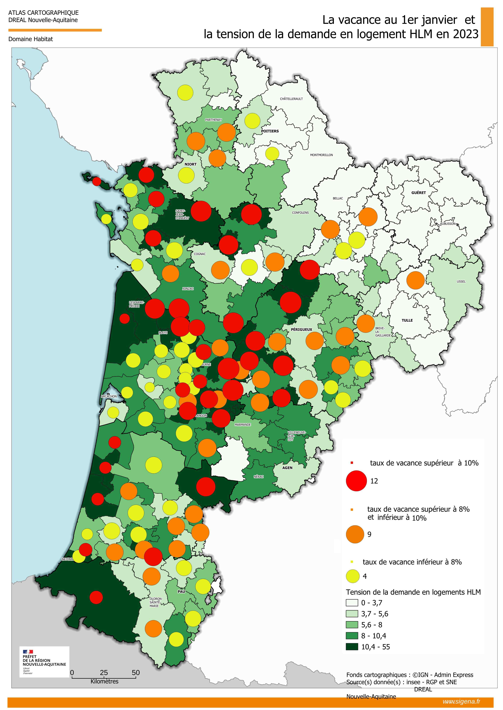

```{=html}
<style>
  p {
  text-align: inherit !important;
  }

.img-stack {
  position: relative;
  width: 100%;
  max-width: 900px;
  margin: auto;
  aspect-ratio: 3 / 1; /* hauteur fluide */
}

/* Images superposées */
.img-stack img {
  position: absolute;
  object-fit: contain;
  max-width: 100%;
  margin-top: -65px;
}

/* Image du dessus */
.img-top {
  width: 60%;
  right: 2%;
  top: 0;
}

/* Image du dessous */
.img-bottom {
  width: 40%;
  right: 35%;
  top: 15%;
}

/* --- Responsive fluide --- */
@media (max-width: 900px) {
  .img-top {
    width: 65%;
    right: 0;
    top: 5%;
  }
  .img-bottom {
    width: 45%;
    right: 30%;
    top: 20%;
  }
}

@media (max-width: 600px) {
  .img-top {
    width: 70%;
    right: 0;
    top: 10%;
  }
  .img-bottom {
    width: 50%;
    right: 25%;
    top: 25%;
  }
}

@media (max-width: 450px) {
  .img-top {
    width: 75%;
    right: 0;
    top: 15%;
  }
  .img-bottom {
    width: 55%;
    right: 20%;
    top: 30%;
  }
}

  
  .triple-overlap {
    position: relative;
    width: 100%;
    display: flex;
    justify-content: center; /* centre le groupe */
    align-items: center;
    text-align: center;
  }

  .triple-overlap img {
    width: 36%; /* taille des images */
  }

  /* Image de gauche */
  .img-left {
    position: relative;
    z-index: 1;
  }

  /* Image du milieu (au-dessus) */
  .img-middle {
    position: relative;
    z-index: 3; /* passe au-dessus */
    margin: 0 -6%; /* chevauchement horizontal */
    margin-top: -4%; /* chevauchement vertical */
  }

  /* Image de droite */
  .img-right {
    position: relative;
    z-index: 1;
  }

  /* Responsive */
  @media (max-width: 800px) {
    .triple-overlap img {
      width: 35%;
    }
    .img-middle {
      margin: 0 -8%;
      margin-top: -6%;
    }
  }

  @media (max-width: 500px) {
    .triple-overlap img {
      width: 45%;
    }
    .img-middle {
      margin: 0 -10%;
      margin-top: -8%;
    }
  }
</style>
```

## 5. La vacance résiduelle du parc social (source RPLS)

::: {style="font-family: YACkoD1yZN0-0;font-size:1.1em;"}
La vacance sur le parc social de plus de deux ans, extrêmement marginale, ne concerne que 948 logements selon LOVAC et sur toute la région, en 2024. Il s’agit en écrasante majorité de logements construits dans les années 50 à 70, petits ou moyens (T1 à T3), quasiment toujours des appartements à une exception près (sur La Rochelle : 28 maisons vacantes).

Dans certains cas, il peut s’agir de logements vacants dans l’attente d’une restructuration ou d’une démolition mais qualifiés comme vacants dans RPLS.

9 communes ont une vacance comprise entre 19 et 108 logements vacants représentant ainsi un potentiel (très modéré) de logements à remettre sur le marché s’il ne s’agit pas de logements en restructuration : Limoges avec 108 LLS vacants, Poitiers avec une soixantaine d’appartements, Niort et La Rochelle avec une quarantaine de logements HLM vacants, Angoulème avec 25 logements, et de quelques plus petites communes : Saint-Junien, Saint-Jean-d’Angely, Blanquefort et Aubusson (ces deux dernières communes comptant presque 50 logements vacants.

C’est un stock relativement notable pour des petites communes. Ces cas de figure ne méritent pas une étude approfondie mais peuvent être relevés. 67,8 % des logements vacants depuis plus de deux ans de la région sont situés sur ces 9 communes citées.

```{=html}
<table class="vacance-table">
  <thead>
    <tr>
      <th>Communes</th>
      <th style="text-align:center;">Département</th>
      <th style="text-align:center;">Nb de lgts vacants +2 ans du parc social</th>
    </tr>
  </thead>

  <tbody>
    <tr><td>LIMOGES</td><td style="text-align:center;">87</td><td style="text-align:center;">108</td></tr>
    <tr><td>POITIERS</td><td style="text-align:center;">86</td><td style="text-align:center;">60</td></tr>
    <tr><td>BLANQUEFORT</td><td style="text-align:center;">33</td><td style="text-align:center;">48</td></tr>
    <tr><td>AUBUSSON</td><td style="text-align:center;">23</td><td style="text-align:center;">47</td></tr>
    <tr><td>NIORT</td><td style="text-align:center;">79</td><td style="text-align:center;">42</td></tr>
    <tr><td>LA ROCHELLE</td><td style="text-align:center;">17</td><td style="text-align:center;">38</td></tr>
    <tr><td>ANGOULEME</td><td style="text-align:center;">16</td><td style="text-align:center;">25</td></tr>
    <tr><td>SAINT-JUNIEN</td><td style="text-align:center;">87</td><td style="text-align:center;">22</td></tr>
    <tr><td>SAINT-JEAN-D'ANGELY</td><td style="text-align:center;">17</td><td style="text-align:center;">19</td></tr>
    <tr><td>LAVAVEIX-LES-MINES</td><td style="text-align:center;">23</td><td style="text-align:center;">12</td></tr>
    <tr><td>BORDEAUX</td><td style="text-align:center;">33</td><td style="text-align:center;">10</td></tr>
    <tr><td>CROCQ</td><td style="text-align:center;">23</td><td style="text-align:center;">9</td></tr>
    <tr><td>COULOUNIEIX-CHAMIERS</td><td style="text-align:center;">24</td><td style="text-align:center;">9</td></tr>
    <tr><td>ROCHEFORT</td><td style="text-align:center;">17</td><td style="text-align:center;">8</td></tr>
    <tr><td>CREYSSE</td><td style="text-align:center;">24</td><td style="text-align:center;">8</td></tr>
  </tbody>
</table>

```

**Vacance et tension de la demande en logement social :**

Le croisement entre le taux de vacance et la tension de la demande en logement social met en évidence des situations territoriales contrastées. Les secteurs où la demande HLM est la plus tendue se concentrent principalement sur le littoral, autour de Bordeaux et dans plusieurs territoires de l’ouest et du sud de la région.

**Une tension élevée n’exclut toutefois pas la présence d’une vacance importante** : plusieurs EPCI cumulent une forte demande en logement social et des taux de vacance élevés.

Ce constat souligne qu’un stock de logements vacants ne constitue pas nécessairement une offre immédiatement mobilisable pour répondre aux besoins sociaux, notamment en raison de sa localisation, de son état, de ses caractéristiques ou de son statut de propriété.

À l’inverse, dans certains territoires peu tendus, une vacance élevée peut davantage traduire une faiblesse générale de la demande en logements.

<div style="text-align:center !important;display:flex; justify-content:center !important;">

{.lightbox style="width:62%;"}

</div>
:::

